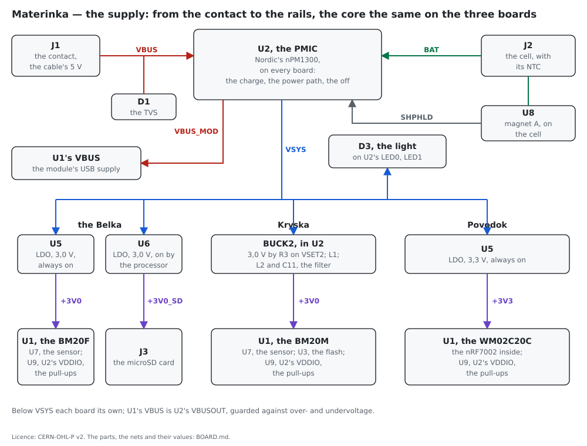
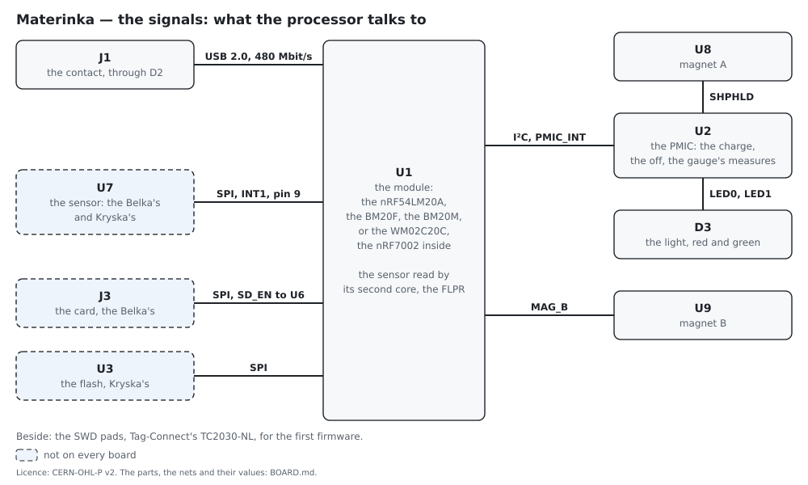

# The board

**Materinka, the base board of each unit: one core drawn the same on each, the schematic as
nets, pin by pin, the values and the bill of materials.**

↑ [NIC-Strelka](README.md)

---

**Materinka** is the base board every unit is built on, each unit its own: **the Belka** with
Fanstel's BM20F, the motion sensor U7, the microSD card J3 and a LiFePO4 cell; **Zvjozdočka**, the
Belka for industry, on the Belka's board with TDK's ICM-42686-P on U7's land; **Kryska** with the
BM20M, the same sensor's land and an SD NAND soldered in the card's place, U3
([`KRYSKA.md`](KRYSKA.md)); **Povodok** with the WM02C20C — the nRF54LM20A and the nRF7002 in one
module — and a Li-ion or Li-poly cell, neither sensor nor memory. **The core is the same on every
board**: the contact and its guards, Nordic's PMIC U2 — the charger, the power path, the off and the
measurements of the fuel gauge in one chip —, the magnets' switches, the light, the cell's connector
and the SWD pads. The firmware is built three times from one source, Zvjozdočka taking the Belka's.
Ugoljok, the Belka for large shocks, on the hoof, differs by its sensor (*U7*) and its sturdier box.

The schematic is written as nets, part by part, with its values and its bill of materials;
`board/nets.py` draws the parts and nets of each board pin by pin —
[the Belka's](board/nets-belka.svg), [Zvjozdočka's](board/nets-zvjozdocka.svg),
[Kryska's](board/nets-kryska.svg), [Povodok's](board/nets-povodok.svg) — and `board/schematic.py`
writes each as a netlist in KiCad's form, every part with its reference, value and LCSC code and
every pin on its net, which EasyEDA Pro imports as it is, no KiCad needed (File → Import → KiCad):
[`belka.kicad_sch`](board/belka.kicad_sch), [`zvjozdocka.kicad_sch`](board/zvjozdocka.kicad_sch),
[`kryska.kicad_sch`](board/kryska.kicad_sch), [`povodok.kicad_sch`](board/povodok.kicad_sch).
The schematics themselves are to be drawn, in EasyEDA for JLCPCB's assembly, the parts by their
LCSC codes, and come into this page as they are drawn; the boards are not drawn.

The boards in two pictures, by `board/blocks.py`: the supply, from the contact to the rails, and
the signals, what the processor talks to.

## The core — the same on every board

**J1, the contact**, Promax's five-pin magnetic pair, 1 A: the NF2347-05B glued into the lid, 27,2 ×
8,0 mm, its face 1,2–1,3 mm over its flange of 2,2, its body 4,0 under it and its pins 0,5 below,
some 7,4 mm in all, its pins of 0,6 mm through the board, pads of 1,6 mm on holes of 0,8 (the
NF2347-05B's drawing); the NC2347-05B on the cable, 26,7 × 7,5 × 7,2 mm
([Promax](https://promaxpogopin.com/magnetic-connectors/waterproof/)), its five pins at 2,2 mm, pin
1 at the mark on its face (the NC2347-05B's drawing). Its magnets' poles opposite, S at one end
and N at the other, so the pair mates one way round alone; wired symmetric besides: pin 1 VBUS, 2
D+, 3 GND, 4 D−, 5 VBUS, so that a plug forced on turned round meets VBUS with VBUS and GND with
GND and swaps D+ with D− alone: the charge either way, USB the right way round, nothing harmed,
and no reverse guard at the inlet. The lid's half works from −20 °C, the cable's from −25 (the
drawings). Kryska carries it for now, a smaller pair of four contacts to be found
([`STATUS.md`](STATUS.md)).

**D1, the TVS at the inlet**, from VBUS to GND: SMF12CA, two-way, standing off 12 V either way,
breaking down at 13,3–14,7 V, clamping 19,9 V at 10,1 A (Hongjiacheng's SMF sheet, Rev 2.2) —
under the 22 V U2's VBUS bears (the nPM1300's product specification v1.1, table 5).

**D2, the ESD guard on the USB pair**, at the contact's pads 2 and 4: Hongjiacheng's H5VUT2U in
SOT-23 — pins 1 and 2 to D+ and D−, 3 to GND, the clamp from pin 1 or 2 to pin 3 — standing off
5,0 V, breaking down at 6,0–9,0 V, 0,6 pF from a line to GND and 0,3 pF between the lines,
±20 kV by contact, 9 V clamped at 1 A (its sheet, ESD-NOV.2023-A1), a JLCPCB preferred part;
the pair's 3,6 V at most lies under its stand-off. TI's
TPD2E2U06DCKR, in SC-70 with the same pins, 1,5 pF a line, made for USB 2.0's 480 Mbit/s (TI
SLLSEG9C), is the extended part it replaced.

### U2 — the PMIC

**Nordic's nPM1300-QEAA**, QFN32 of 5 × 5 mm, the pad AVSS, on every board, Kryska's too
([`KRYSKA.md`](KRYSKA.md)). The
pins and the figures are the nPM1300's product specification's, v1.1 (4490_483), its pin table
(table 35) and its reference configurations (9.3): the Belka and Povodok wired as its full one
(figure 54, table 40) with the bucks and the load switches left out — ship mode's exit, the
thermistor, the LEDs and VBUSOUT all in use, which the minimal configuration has not — Kryska as
its simple one, one buck running (figure 56), BUCK2 in BUCK1's place.

| pin | name | the Belka and Povodok | Kryska |
|---|---|---|---|
| 21 | VBUS | VBUS: C1 1 µF and C2 100 nF | the same |
| 22 | VBUSOUT | VBUS_MOD, to U1's VBUS: C3 1 µF | the same |
| 20 | VSYS | VSYS: C5 10 µF and C6 100 nF | the same |
| 4 | PVDD | VSYS | VSYS; C26 10 µF to PVSS2 |
| 1 | VOUT1 | VSYS | VSYS |
| 32 | VOUT2 | VSYS | BUCK2, the buck's output and its sense |
| 3, 5 | SW1, SW2 | open | SW1 open; SW2 to L1 |
| 2, 6 | PVSS1, PVSS2 | GND | GND |
| 17, 16 | VSET1, VSET2 | GND | VSET1 GND; VSET2 through R3 150 kΩ to GND — 3,0 V |
| 19 | VBAT | BAT, the cell's plus: C7 2,2 µF | the same |
| 18 | NTC | NTC, the cell's thermistor | the same |
| 15 | SHPHLD | HALL_A, magnet A's switch U8 | the same |
| 7 | GPIO0 | PMIC_INT, to P0.00 | the same |
| 8–11 | GPIO1–GPIO4 | open | open |
| 12 | VDDIO | the rail, +3V0, on Povodok +3V3: C8 100 nF | +3V0 |
| 13, 14 | SDA, SCL | SDA, SCL: P0.03 and P0.04, R9 and R8 10 kΩ to the rail | the same |
| 25 | LED0 | LED_R, through R17 1,5 kΩ to D3's red cathode | the same |
| 26 | LED1 | LED_G, through R18 1,5 kΩ to D3's green cathode | the same |
| 27 | LED2 | open | open |
| 23, 24 | CC1, CC2 | open | open |
| 28, 30 | LSIN1, LSIN2 | GND | GND |
| 29, 31 | LSOUT1, LSOUT2 | GND | GND |
| pad | AVSS | GND | GND |

- **The power path** (6.2.10): on the cable VBUS feeds VSYS and the cell charges from what is
  left, the board's load first; the cell, once full, is parted from VSYS; off the cable the cell
  feeds VSYS through 160 mΩ (RONCHARGER). VSYS carries VBUS unregulated while the cable is in
  (6.1.1), 300 mΩ from it (RON), cut above 5,5 V (VBUSOVP): what hangs on VSYS bears it — the
  LDOs' 6,0 V (SBVS338H, the recommended conditions), Kryska's buck, the light.
- **The USB input** is limited to 100 mA from the PMIC's every reset — its power-on, ship mode left
  — until the firmware raises it, to 1,5 A at most (6.1.3); a cable plugged in again takes the
  startup limit the firmware has written, VBUSINILIMSTARTUP (6.1.8.1); CC1 and CC2 are left open,
  the contact having none, "If USB Type-C configuration is not used, CC1 and CC2 can be left
  floating".
- **VBUSOUT** feeds the module's VBUS, guarded against over- and undervoltage, through 7,5 Ω
  (6.1.5); the nRF54LM20A takes from it its 3,3 V regulator for the USB's lines alone (its
  datasheet v1.0, 5.9.1). Nordic confirms it a common and supported use for an nRF5x's VBUS, the
  sheet's "only for host sensing" (8.3) meaning no generic supply drawn from it (DevZone, 10 Nov
  2026); the regulator's current from VBUS is published nowhere and is measured on the kit
  ([`STATUS.md`](STATUS.md), *Awaiting measurement*). At the module's VBUS, **C4, 10 µF**, some
  6,9 µF kept at 5,5 V: Nordic's reference puts 4,7 µF at the chip's VBUS behind 2,2 Ω (the
  nRF54LM20A datasheet v1.0, figure 189 and table 88, C11 and R1), and Fanstel's evaluation board
  the same (the BM20C specification v1.00, EV-BM20BC, page 2); VBUSOUT's own 7,5 Ω stands for the
  resistor. The PMIC's application example puts 1 µF there (figure 54), C3 here, at U2.
- **The off is ship mode**, 370 nA (IQSHIP, table 4): the cell parted from the board. It is left
  by SHPHLD held low for 96 ms, as reset, 16–3 008 ms as the firmware sets it, or by VBUS rising
  over 3,9 V (VBUSPOR) — magnet A or the cable (7.4); the firmware enters it, once the cable is
  out. The cable thus wakes every unit; what each does then is the firmware's
  ([`FIRMWARE.md`](FIRMWARE.md)).
- **SHPHLD, magnet A**: U8's open drain, pulled up inside by 50 kΩ to the higher of VBAT and VBUS
  (RSHPHLD). While the board runs, a hold and its release are events the PMIC reports on
  PMIC_INT (EVENTSSHPHLDSET, 7.7.1.18), so the processor reads magnet A through the PMIC and no
  pin of it touches the line: a dead processor cannot hold the board on. A low held over 10 s
  power-cycles the board (tRESETBUT, 7.5), left on as it is reset: the rescue of a unit whose
  firmware hangs in its glued box ([`FIRMWARE.md`](FIRMWARE.md), *The magnets and the light*).
- **The charger** is off from power-on until the firmware enables it (BCHGENABLESET, reset 0):
  LiFePO4 to 3,50–3,65 V, Li-ion to 4,00–4,45 V, in steps of 50 mV, 32–800 mA in steps of 2 mA
  (6.2.12); the cell's NTC, 10 kΩ and B 3 380 K between 25 and 50 °C (table 12), stops it out
  of its window; the cell feeds up to 1 A, the higher of the two limits, as reset (table 16;
  BCHGISETDISCHARGEMSB, reset 0xCF). Each board's settings are in its section.
- **The light**: LED0 and LED1 sink 5 mA at most (table 25), each through its resistor, R17 or R18,
  D3's anodes on VSYS as Nordic asks (6.5); from reset LED0 shows the charger's error and LED1
  lights while it charges (LEDDRV0MODESEL, LEDDRV1MODESEL), with no firmware; the firmware takes
  either for its own patterns.
- **The TWI** on P0.04 and P0.03, R8 and R9 10 kΩ to the rail, VDDIO on the rail; **GPIO0**,
  PMIC_INT, the PMIC's interrupt to P0.00, a P0 pin, which wakes the processor from System OFF;
  GPIO1–4 open, inputs pulled down inside after reset (6.6).
- **The gauge**: the PMIC measures the cell's voltage, current and temperature, and Nordic's fuel
  gauge in the SDK makes the cell's state of them, "comparable to Coulomb counters at a
  significantly lower power consumption" (its introduction); the cell's minus goes straight to
  the ground plane, no resistor in it.
- **Its capacitors** are Nordic's (tables 40–42): C1 1 µF at VBUS, C3 1 µF at VBUSOUT, C5 10 µF at
  VSYS and PVDD — the bucks unused wired as its minimal configuration, VOUT1, VOUT2 and PVDD on
  VSYS, SW1 and SW2 open, VSET1 and VSET2 grounded (figure 58) — C7 2,2 µF at VBAT, C8 100 nF at
  VDDIO; on Kryska C26 10 µF at PVDD and C27 10 µF at the buck's output.
- **From the cell**: running, the PMIC's own 0,8 µA with no buck loaded (IQBAT, table 4); off,
  370 nA, and U8's 1,6 µA, **some 2 µA** in all.

**U8 and U9, the magnets' switches**, TI DRV5032ZE, Hall switches of open drain, SOT-23: pin 1
VCC, 2 OUT, 3 GND (SLVSDC7H, table 5-1), 100 nF at each VCC (TI: "at least 0.1 µF"). **U8,
magnet A**, VCC on BAT with C9, so that it works with the board off; its OUT on HALL_A, U2's
SHPHLD. **U9, magnet B**, VCC on the rail with C10, its OUT, MAG_B, to P0.02, held up by the
processor pin's own pull-up, 12–16 kΩ (the nRF54LM20A datasheet, 11.7.1), some 0,2 mA only while
the magnet is held. Both poles, operating from ±33 to ±63 mT and released from ±30 to ±58 mT
(6.6): a strong magnet held at the mark, not a stray one. The field sampled at 20 Hz (13,3–37),
a magnet seen within 75 ms; 1,6 µA each at 3 V, 3,5 µA at most. They sit low in the box at its
two opposite sides, each under a mark, some 20 mm or more from the contact in the lid, whose
magnets could otherwise close them.

**D3, the light**, Lite-On's LTST-C195KGJRKT, red and green in 1,6 × 1,5 mm: pads 1 and 2, the
anodes, on VSYS; pad 3, the green cathode, to U2's LED1; pad 4, the red cathode, to U2's LED0
(Lite-On's sheet, the polarity drawing), each cathode through its resistor, **R17 and R18, 1,5 kΩ**.
U2's drivers hold 5 mA only while their pin keeps 0,5 V (table 25); the resistor takes that from
them, and a driver left so is a switch, as in the open-drain use Nordic gives with a pull-up
resistor (6.5). The current is then VSYS less the forward voltage, over the resistor: some 1 mA
from the Belka's LiFePO4 at 3,2 V, the forward voltage at 1 mA taken as some 1,8 V, below the
sheet's 2,0 V at 20 mA; a little more from a Li-ion cell, some 2 mA on the cable, whose VBUS is
VSYS's supply (6.1.1). A fifth of the light's current on the cell, and so of what its blinks take,
and some fifth of its brightness, 25–35 mcd at 20 mA (Lite-On's sheet): seen
indoors, faint in the sun, and less to startle an animal. The value is settled by eye on the kit.

**J2, the cell**, JST S3B-PH-SM4-TB, three pins: BAT, GND and NTC, in the order of the cell's
lead.

**The SWD pads**, Tag-Connect's TC2030-NL footprint for its TC2030-CTX-NL cable: six pads at
1,27 mm and three alignment holes, no part: 1 the rail, 2 SWDIO (U1 J3), 3 NRESET (U1 G2), 4
SWDCLK (U1 K3), 5 GND, 6 unconnected, SWO (Tag-Connect's TC2030-CTX sheet). No paste on its pads,
no track or via in its keep-out (the TC2030-IDC-NL footprint's notes). The cable's other end,
ARM's 10-pin Cortex connector, goes on the development kit's Debug out, P13, which programs an
outside board when the 10-pin's pin 3 is grounded (the kit's guide, 3.3, table 12) — the board fed
by its own cell or cable, its rail within the 1,8–3,6 V the kit asks, the cable 10 cm at the most
(the same, 3.3). SWD serves
the first programming and the bench; after it the firmware comes over USB through the contact.

**TP1–TP3, the test pads**, bare copper for a probe: TP1 VSYS and TP3 VBUS on every board; TP2
+3V0_SD on the Belka, +3V0 after the filter on Kryska.

## U1 — the module

The pads and the nRF54LM20A's pins they carry are from Fanstel's BM20C series specification,
version 1.00, the pin table, each checked in its BM20 and WM20 columns, so that the wiring holds
for the BM20F, the BM20M and the WM02C20C alike, every module of the series on the same land;
the WM02C20C's own specification, draft 0.82, gives its footprint as compatible with the BM20C
series. The crystals, the antenna, the DC/DC inductors and the chip's decoupling are inside the
module.

| pad | pin | the Belka | Kryska | Povodok |
|---|---|---|---|---|
| B8, C7, C8 | VDD | +3V0 | +3V0 | +3V3 |
| H7 | VBUS | VBUS_MOD, U2's VBUSOUT; C4 10 µF at the pad | the same | the same |
| G7, G6 | D+, D− | USB_DP, USB_DM: J1 pins 2 and 4, straight; D2 at the contact; a 90 Ω pair, short and straight, nothing in series: "The data line does not need serial resistors", the chip setting its own 45 Ω by the TXRTUNE resistor inside the module (the nRF54LM20A datasheet v1.0, 8.27.1) — Fanstel's evaluation board's 33 Ω left out | the same | the same |
| J3, K3 | SWDIO, SWDCLK | the SWD pads 2 and 4 | the same | the same |
| G2 | /Reset | NRESET, the SWD pad 3; its pull-up inside the chip | the same | the same |
| C3 | P3.04 | IMU_SCK, U7 pin 13; a clock pin (table 83) | the same | open |
| H2 | P3.05 | IMU_SDI, U7 pin 14 | the same | open |
| C9 | P3.07 | IMU_SDO, U7 pin 1 | the same | open |
| D7 | P3.02 | IMU_CS, U7 pin 12; R11 100 kΩ to +3V0 | the same | open |
| E6 | P3.01 | IMU_INT1, U7 pin 4 | the same | open |
| K5 | P3.00 | IMU_CLKIN, U7 pin 9 through R23 1 kΩ | the same | open |
| A7 | P3.03 | SD_CLK, J3 pin 5; a clock pin (table 83) | SD_CLK, U3 pad 3 | open |
| D4 | P3.08 | SD_DI, J3 pin 3 | SD_DI, U3 pad 5 | open |
| K7 | P3.09 | SD_DO, J3 pin 7 | SD_DO, U3 pad 6 | open |
| K2 | P3.10 | SD_CS, J3 pin 2 | SD_CS, U3 pad 2 | open |
| D8 | P3.06 | SD_EN, U6 EN (3), held low inside U6 by 500 kΩ | the same | open |
| C2 | P0.04 | SCL, U2 pin 14; R8 10 kΩ to the rail | the same | the same |
| E7 | P0.03 | SDA, U2 pin 13; R9 10 kΩ to the rail | the same | the same |
| A5 | P0.00 | PMIC_INT, U2's GPIO0; wakes the chip from System OFF | the same | the same |
| A6 | P0.02 | MAG_B, U9 pin 2; wakes the chip from System OFF | the same | the same |
| A1, A9, B1, B7, B9, C1, D1, E1, F1, G1, H1, H8, J1, K1 | GND | each to the plane | the same | the same |

Joined: 38 pads of 90 on the Belka, Zvjozdočka and Kryska, 27 on Povodok. **Left open:**
P1.04–P1.14, unconnected on the WM02C20C, whose nRF7002 they control inside the module, and free on
the BM20F and the BM20M; A2, which feeds the power amplifier of the BM20NE and BM20XE alone; NFC
(C4, A8) and every other GPIO, each given a pull by the firmware.

**Why the pins are where they are**: a peripheral takes its pins on one port (8.9.3); SCK and SCL
sit on clock pins (tables 79 and 83) — P3 has two, P3.04 for the sensor's clock and P3.03 for the
card's; PMIC_INT and magnet B are on P0, since P2's pins cannot wake the chip from
System OFF (table 41); the sensor and the memory are on SPIM21 and SPIM20 in the peripheral
domain, whose clock runs from 127 kHz, under the 400 kHz a card asks at its identification, up to
8 Mbit/s (11.19.1); none of the pins clashes with what Nordic's development kit uses for itself
(its guide v0.7.0, tables 1–4 and 10).

**The antenna**: the module sits at the board's edge, its antenna over a place with no copper on
either layer, no ground plane under it and no metal within 30 mm of it, no signal line run under
the module where it can be helped; the BM20M's antenna area 3,7 mm long, past its shield of
10,3 mm (Fanstel's BM20C specification v1.00, *Mounting BM20C on the Host PCB* and *Notes on
Antenna and PCB Layout*). Each board's end is sized to its module: the BM20F's 15,2 mm width at its
antenna, the BM20M's 10,0 × 14,0 mm, the WM02C20C's 24,0 mm of length.

## The Belka

The BM20F, a LiFePO4 cell, the sensor and the card; U2 the nPM1300, its bucks unused.

| net | from | to | capacitors |
|---|---|---|---|
| VBUS | J1 pins 1 and 5, the contact | D1, the TVS; U2 VBUS (21); TP3 | C1 1 µF and C2 100 nF at U2 |
| VBUS_MOD | U2 VBUSOUT (22) | U1 VBUS (H7), the processor's USB supply | C3 1 µF at U2; C4 10 µF at H7 |
| VSYS | U2 VSYS (20), with PVDD (4), VOUT1 (1) and VOUT2 (32) | U5 IN (4) and EN (3); U6 IN (4); D3's anodes; TP1 | C5 10 µF and C6 100 nF at U2; C13 1 µF at U5's input; C16 1 µF at U6's input |
| BAT | the cell's plus through J2 | U2 VBAT (19); U8 VCC (1) | C7 2,2 µF at U2; C9 100 nF at U8 |
| NTC | the cell's thermistor through J2 | U2 NTC (18) | — |
| +3V0 | U5 OUT (1) | U1 VDD (B8, C7, C8); FB1; U7 VDDIO (5); U9 VCC (1); U2 VDDIO (12); R8, R9, R11; the SWD pad 1 | C14 1 µF and C15 100 nF at U5; C11 100 µF and C12 100 nF at U1; C25 100 nF at U7's VDDIO; C10 100 nF at U9; C8 100 nF at U2's VDDIO |
| +3V0_SD | U6 OUT (1), its EN (3) from P3.06 | J3 VDD (4); R12–R16; TP2 | C17 1 µF and C18 100 nF at J3 |
| +3V0_IMU | FB1, the ferrite bead, from +3V0 | U7 VDD (8) | C20 1 µF and C22 100 nF at U7; the pads of C19, C21, C23 and C24, TDK's set, left empty — Zvjozdočka's |
| GND | one plane | every ground below; the cell's minus through J2 | — |

**U5 and U6, the LDOs**, TI TPS7A2030PDQNR, 3,0 V, X2SON of 1 × 1 mm: 1 OUT, 2 GND, 3 EN, 4 IN,
5 the thermal pad, joined to GND on the top layer beside pin 2, no via (SBVS338H, the pin
functions). U5 has IN and EN on VSYS and runs always: the module, the sensor, magnet B's switch,
the PMIC's VDDIO and the pull-ups; U6 has IN on VSYS and EN from P3.06, held low by 500 kΩ inside
it until the processor drives it, and feeds the card alone. Each has 1 µF at its input, C13 and
C16, against TI's 0,47 µF effective at the least (SBVS338H, 5.3, note 2), U6 standing by the card,
away from U2's C5. Each gives 300 mA, limited at
360–730 mA; 6,5 µA of its own, 8,5 µA at most at 25 °C, 0,07 µA disabled; in dropout 140 mV at
most at 300 mA. Disabled, each discharges its output through 150 Ω; each starts in
750–1 150 µs (tSTR). On the cable VSYS stands near VBUS, 5 V: U6 at the card's 100 mA loses
(5,0 − 3,0) V × 0,1 A = 0,2 W, some 33 °C over its board at 166,1 °C/W (SBVS338H, 5.4).

**The charge**, set by the firmware: **3,50 V**, for the LiFePO4 cell's life, 93,2 % of its
capacity against 98,3 % at 3,61 V (TI's SLUAAR1, table 2-1); **300 mA**, under the LFP103042's
standard 360 mA ([`PARTS.md`](PARTS.md)); the USB input raised to 500 mA, the charge and the
board's load within it. The cell is used down to 3,1 V, where the firmware switches the unit off;
the cell's own board cuts it at 2,3 V.

**From the cell**, the board's supply: running, U2's 0,8 µA, U5's 6,5 µA, U6's 0,07 µA and the
Hall switches' 3,2 µA, **some 10,6 µA**; off, **some 2 µA** (*U2*).

### U7 — the motion sensor

**One land for three sensors**, LGA-14 of 2,5 × 3 mm at a pitch of 0,5 mm, pads of 0,25 × 0,475 mm
on all three (DS13510 Rev 4, figure 33; DS14623 Rev 3, figure 31; DS-000639 v1.0, 10.2): **ST's
LSM6DSV16X** for the classic build, **ST's LSM6DSV320X** for the hoof, **TDK's ICM-42686-P** for the
industrial one, Zvjozdočka, the ICM-42688-P on the ICM's fitting as an option; the firmware tells
them by WHO_AM_I. **Fitted**: the Belka with the LSM6DSV16X, Ugoljok with the LSM6DSV320X, Kryska
with the LSM6DSV320X alone; the ICM is Zvjozdočka's alone, a Belka with an ICM being a Zvjozdočka.
The pins (DS13510, tables 2 and 23; DS-000639, table 10); the LSM6DSV320X's are the LSM6DSV16X's, by
name and use (DS14623 Rev 3, table 2):

| pin | LSM6DSV16X | ICM-42686-P | net |
|---|---|---|---|
| 1 | SDO | AP_SDO | IMU_SDO, P3.07 |
| 2, 3 | SDx, SCx: "Connect to Vdd_IO or GND" | RESV: "No Connect or Connect to GND" | GND |
| 4 | INT1 | INT1 | IMU_INT1, P3.01 |
| 5 | Vdd_IO | VDDIO | +3V0, C25 100 nF |
| 6 | GND | GND | GND |
| 7 | GND | RESV: "Connect to GND" | GND |
| 8 | Vdd | VDD | +3V0_IMU |
| 9 | INT2, the reference | INT2 / FSYNC / CLKIN | IMU_PIN9, through R23 1 kΩ to IMU_CLKIN, P3.00 |
| 10 | OCS_Aux: "Connect to Vdd_IO or leave unconnected" | RESV: "No Connect or Connect to GND" | open |
| 11 | SDO_Aux: "Connect to Vdd_IO or leave unconnected", a pull-up inside | RESV: "Connect to GND" | IMU_PIN11, R24 0 Ω to GND with an ICM alone |
| 12 | CS | AP_CS | IMU_CS, P3.02; R11 100 kΩ to +3V0 |
| 13 | SCL / SPC | AP_SCLK | IMU_SCK, P3.04 |
| 14 | SDA / SDI | AP_SDI | IMU_SDI, P3.05 |

**R24**, 0 Ω, is fitted on Zvjozdočka alone, its pads empty on the Belka; Kryska has no R24, pin
11 open. **R23**, 1 kΩ in pin 9's line, guards the processor's pin: every sensor holds pin 9 low as
an output after its reset — the LSMs' INT2 "output forced to ground" (DS13510, table 23; DS14623,
table 25), the ICM-42686-P's an open-drain output — so a sensor reset while the line is driven
meets 3 mA at most; with the pin's input capacitance, under 10 pF (DS-000639, table 4), it slows
an edge by 10 ns at most, against the 5–500 ns CLKIN allows (table 8).

**FB1**, Murata's BLM18PG121SN1D, 120 Ω ±25 % at 100 MHz, 2 A, 50 mΩ at most (Murata's catalog
C31E12) — some 45 µV at the most a sensor draws, the LSM6DSV320X's 0,9 mA — from +3V0 to +3V0_IMU,
with C19 100 nF at its input and C20, C21 1 µF, C22, C23 100 nF and C24 1 nF at the sensor's VDD,
against TDK's 2,2 µF and 0,1 µF (table 11) and ST's 100 nF at each supply pin (DS13510 and DS14623,
table 2). **TDK's set — C19, C21, C23 and C24 — is fitted on Zvjozdočka alone**, its pads empty on
the Belka, which keeps ST's, C22 at VDD and C25 at VDDIO, as Kryska does, and on both **C20, 1 µF,
at VDD besides**, a margin over ST's 100 nF. Zvjozdočka's two 1 µF, X7R in
0805, keep some 2,0 µF at 3,0 V, where the basic 2,2 µF, X5R in 0603, keeps some 1,3 µF at 3,5 V
(*The capacitors*). **R11** keeps the sensor off the bus while the processor is held in reset or
programmed; at 100 kΩ it draws some 15 µA on average while the sensor is read at 32 kHz, its CS low
some half of the time.

For the firmware: on the ICM-42686-P, INT1 is an open-drain output after reset (INT_CONFIG, reset
0x00), set to push-pull before the data-ready is awaited; pin 9 is INT2 after reset (INTF_CONFIG5,
PIN9_FUNCTION 00), and the clock is driven onto it only once it is set to CLKIN. On the LSM6DSV16X,
pin 9 is driven only once the ODR-triggered mode is set (DS13510, 6.6), and the pull-ups of pins 10
and 11 are left on, pin 11 open. On the LSM6DSV320X pin 9 is never driven: the sensor runs on its
own clock and keeps its INT2. Pin 9 is wired through R23 on every board, so that each can take a
steered sensor again, and is driven by none now: every sensor runs on its own clock at its fastest
and its samples are filtered onto the grid ([`FIRMWARE.md`](FIRMWARE.md), *The sensor and its
clock*).

**The axes are the same on all three.** Seen from above, the package 3 mm wide and 2,5 mm high, its
pin 1 at the top left and pins 1–4 down its left side (DS13510 Rev 4, figure 33; DS14623 Rev 3,
figure 31; DS-000639 v1.0, 10.2): **+X to the right, along the 3 mm side; +Y up; +Z out of the
package's top** — ST's figure 5 in both its sheets and TDK's figure 16, the ICM-42688-P's alike
(DS-000347 v1.9, figure 16), draw the same axes, the pin 1 mark at the corner of the least X and
the most Y. Lying flat, top up, either reads +1 g on Z
(DS-000639, 4.7; AN5763 Rev 4, figure 14 and table 38, case (e)); a turn is positive by the
right-hand rule on all, as their figures draw it. So a record's x, y, z are the same on every
build, and the firmware takes them as the sensor gives them, nothing remapped. When the board is
drawn, U7 sits square to its edges and its X and Y are drawn on the silkscreen beside it, so that
the box's label can show them.

### J3 — the card

**Megastar's ZX-TF-281.6J**, a microSD slot with a lid sliding to lock in a steel shell, eight
contacts and four shell pads, no card-detect switch (its drawing), with U6, R12–R16, C16, C17 and
C18. The card works in SPI mode; the contacts by ATP's microSD sheet, table 2-0:

| pin | the card's | net |
|---|---|---|
| 1 | DAT2, unused | R12 100 kΩ to +3V0_SD |
| 2 | CD/DAT3 — CS | SD_CS, P3.10; R13 100 kΩ to +3V0_SD |
| 3 | CMD — DI | SD_DI, P3.08; R14 100 kΩ to +3V0_SD |
| 4 | VDD | +3V0_SD; C17 1 µF and C18 100 nF |
| 5 | CLK | SD_CLK, P3.03, a clock pin |
| 6 | VSS | GND |
| 7 | DAT0 — DO | SD_DO, P3.09; R15 100 kΩ to +3V0_SD |
| 8 | DAT1, unused | R16 100 kΩ to +3V0_SD |
| shell | — | GND |

**The pull-ups**, 10–100 kΩ on CMD and DAT "to prevent bus floating" (the bus's line load, as
ATP's sheet gives it, table 4-4; the SD Association's simplified specification leaves that table
out), on +3V0_SD, not +3V0: "during power down, DAT, CMD, and CLK should be disconnected or driven
to logical 0" (the Physical Layer Simplified Specification 9.10, 6.4.1.5), so that a card switched
off is not fed through its lines; they draw nothing then. **U6 sits beside the slot**, its C17 and
C18 at pin 4. The card in SPI mode draws up to 100 mA, averaged over a second (ATP, 4.1–4.2).
U6 starts in 750–1 150 µs (tSTR), within the ramp of 0,1–35 ms the card asks (6.4.1.4); switched
off, it takes 1,1 µF below 0,5 V through its 150 Ω in some 0,30 ms, 165 µs × ln 6, against the
1 ms asked (6.4.1.3).

For the firmware: P3.03, P3.08 and P3.10 low or disconnected before EN falls; the card kept off
for 10 ms, its own capacitance unknown; after EN rises, 1 ms, then 74 clocks with CS high, then
CMD0 with CS low for SPI mode (6.4.1.1); the card known by its answer, the slot having no switch.
No ESD parts on the card's lines: the slot sits inside the closed box. In SPI mode a card of up
to 2 TB is read, SDSC, SDHC and SDXC — "SPI Mode is not supported by SDUC cards" (7).

## Zvjozdočka

The Belka's board, its parts and nets the same: TDK's ICM-42686-P on U7's land, the ICM-42688-P an
option, with R24 and TDK's set fitted, C19, C21, C23 and C24, whose pads the Belka leaves empty
(*U7*, above); the Belka's firmware, which tells her
by her sensor.

## Kryska

The BM20M, the sensor's land and the SD NAND, U3, on the Belka's card's pins and switched
supply, U6; U2 the nPM1300, its BUCK2 feeding the board through a filter ([`KRYSKA.md`](KRYSKA.md),
*The way taken*).

| net | from | to | capacitors |
|---|---|---|---|
| VBUS | J1 pins 1 and 5, the contact | D1, the TVS; U2 VBUS (21); TP3 | C1 1 µF and C2 100 nF at U2 |
| VBUS_MOD | U2 VBUSOUT (22) | U1 VBUS (H7) | C3 1 µF at U2; C4 10 µF at H7 |
| VSYS | U2 VSYS (20), with VOUT1 (1) | U2 PVDD (4), the buck's input; U6 IN (4); D3's anodes; TP1 | C5 10 µF and C6 100 nF at VSYS; C26 10 µF at PVDD, to PVSS2; C16 1 µF at U6's input |
| BAT | the cell's plus through J2 | U2 VBAT (19); U8 VCC (1) | C7 2,2 µF at U2; C9 100 nF at U8 |
| NTC | the cell's thermistor through J2 | U2 NTC (18) | — |
| SW2 | U2 SW2 (5) | L1 | — |
| BUCK2 | L1, the buck's inductor | U2 VOUT2 (32), the buck's sense; L2 | C27 10 µF |
| +3V0 | L2, the filter's inductor | U1 VDD (B8, C7, C8); FB1; U7 VDDIO (5); U9 VCC (1); U2 VDDIO (12); R8, R9, R11; the SWD pad 1; TP2 | C11 100 µF and C12 100 nF at U1, the filter's; C25 100 nF at U7's VDDIO; C10 100 nF at U9; C8 100 nF at U2's VDDIO |
| +3V0_IMU | FB1, from +3V0 | U7 VDD (8) | C20 1 µF and C22 100 nF at U7's VDD: ST's 100 nF (DS14623 Rev 3, table 2) and 1 µF besides |
| +3V0_SD | U6 OUT (1), its EN (3) from P3.06 | U3 VCC (8); R12–R16 | C29 2,2 µF and C18 100 nF at U3 |
| GND | one plane | every ground below; the cell's minus through J2 | — |

**The buck, U2's BUCK2, at 3,0 V** from power-on by R3, 150 kΩ on VSET2, nothing written to it
(table 19); 1,0–3,3 V by its registers, ±5 %, 200 mA, switching at 3,6 MHz in PWM, its own start in
1,2 ms; 100 mV of dropout at 1 mA, so a cell under some 3,1 V lets +3V0 follow it down (6.3.6).
**L1**, Sunlord's WPN201610H2R2MT, 2,2 µH ±20 % at 1 MHz, 2,0 × 1,6 × 1,0 mm, 170 mΩ at most,
saturating at 1,90 A and warmed 40 °C by 1,45 A, the least of each (C97005; Sunlord's WPN201610H
sheet, released 26 Jan 2014), against Nordic's 2,2 µH ±20 %, 400 mΩ at most, over 350 mA of
saturation and 200 mA rated (table 20); **C27**, 10 µF, against Nordic's 10 µF, 10 V at least, 50 mΩ
at most (table 21). Under 90 mA of load it runs hysteretic, back from PWM under 40 mA (IPWMTHRES,
IHYSTTHRES), and there leaves 50 mV of ripple, 5 mV in PWM (6.3.6). PWM is forced over the TWI,
BUCK2PWMSET, or by a GPIO of the PMIC's, and takes some 90 µs to settle into (tPWMMODE, 6.3.6), 35
µs back: over the TWI, already wired, it takes no pin of its own.

**The filter, L2 and C11**: the second WPN201610H2R2MT, 2,2 µH and 170 mΩ, from BUCK2 to +3V0,
and C11, the module's 100 µF in 1206 (*The capacitors*). It keeps the buck's ripple off the module
and the sensor, as the module asks a supply "free of AC ripple" ([`PARTS.md`](PARTS.md), *The
Belka*); the buck's bursts at a light load, under its corner, pass it, and the kit measures them:

<!-- calc:kryska-filter -->
C11 keeps some 49,2 µF at 3,0 V. The corner, 1 / (2π √(L × C)), is some 15 kHz; the impedance √(L /
C) 0,21 Ω; the Q with L2's 170 mΩ 1,2, so 1,9 dB at the corner and a peak of 2,7 dB just under it,
falling 40 dB a decade above. Outside the buck's loop, L2 drops some 4 mV at the SD NAND's 25 mA.
<!-- /calc -->

**The charge**, set by the firmware for the cell chosen with the box, 32 mA, the nPM1300's least,
within half the cell's capacity an hour, between 0 and 45 °C by its NTC ([`KRYSKA.md`](KRYSKA.md)).

**From the cell**, the board's supply: off, **some 2 µA** (*U2*); running, the PMIC, the buck in
its hysteretic mode and the Hall switches, measured on the kit.

### U7 — the motion sensor

The Belka's land, *U7* above, fitted with ST's LSM6DSV320X alone, and its supply as ST asks it,
100 nF at each supply pin (DS14623 Rev 3, table 2), with 1 µF at VDD besides, as the Belka's: FB1,
C20 and C22 at VDD, C25 at VDDIO, R11 and R23, pin 9 wired as on every board; pin 11 open, no R24
— C19, C21, C23 and C24, which
TDK's ICM asks, left out. **J2** is a
JST SH of 1,0 mm, three pins, SM03B-SRSS-TB or a like one, 5,0 × 4,25 × 2,9 mm, its pins at 1,0 mm
(JST's SR/SZ catalog), on the bottom beside the cell, out of the strip the cell leaves free towards
the antenna; the cell comes with its SH plug and its NTC.

### U3 — the SD NAND

**CS's CSNP1GCR01-BOW**, an SD NAND of 1 Gbit — NAND flash and an SD controller in one package,
its bad blocks and its ECC its own — LGA-8 of 8 × 6 × 0,75 mm (C2691593), in the Belka's card's
place: the same pins on SPIM20 in SPI mode, the same supply switched by U6 and the same pull-ups,
so that the Belka's firmware serves it as its card (its sheet, V1.1, 1.1–1.2). Beside the module's
body, never under its antenna. The pads by the same sheet, 2.1, in SPI mode:

| pad | name | net |
|---|---|---|
| 1 | SDD2, reserved | R12 100 kΩ to +3V0_SD |
| 2 | CD/SDD3 — CS | SD_CS, P3.10; R13 100 kΩ to +3V0_SD |
| 3 | SCLK | SD_CLK, P3.03, a clock pin |
| 4 | VSS | GND |
| 5 | CMD — DI | SD_DI, P3.08; R14 100 kΩ to +3V0_SD |
| 6 | SDD0 — DO | SD_DO, P3.09; R15 100 kΩ to +3V0_SD |
| 7 | SDD1, reserved | R16 100 kΩ to +3V0_SD |
| 8 | VCC | +3V0_SD; C29 2,2 µF and C18 100 nF |

Its reference design asks pull-ups of 10–100 kΩ on CMD and every data line, 2,2 µF on VCC and
0–120 Ω in the clock, here none (6). It works from −30 to +85 °C and draws 150–200 µA standing,
15–25 mA at work (3; 4): **U6 switches it off** between the records as the Belka's card, so that
the standing current is paid only while one runs, and the pull-ups sit on +3V0_SD for the card's
reason (*J3*, above). U6, C16 and the resistors are the Belka's; C29 is the SD NAND's own 2,2 µF,
where the card has its 1 µF.

## Povodok

The WM02C20C, a Li-ion or Li-poly cell; U2 the nPM1300, its bucks unused; neither sensor nor
memory, U6, U7, J3 and their parts not on the board.

| net | from | to | capacitors |
|---|---|---|---|
| VBUS | J1 pins 1 and 5, the contact | D1, the TVS; U2 VBUS (21); TP3 | C1 1 µF and C2 100 nF at U2 |
| VBUS_MOD | U2 VBUSOUT (22) | U1 VBUS (H7) | C3 1 µF at U2; C4 10 µF at H7 |
| VSYS | U2 VSYS (20), with PVDD (4), VOUT1 (1) and VOUT2 (32) | U5 IN (4) and EN (3); D3's anodes; TP1 | C5 10 µF and C6 100 nF at U2; C13 1 µF at U5's input |
| BAT | the cell's plus through J2 | U2 VBAT (19); U8 VCC (1) | C7 2,2 µF at U2; C9 100 nF at U8 |
| NTC | the cell's thermistor through J2 | U2 NTC (18) | — |
| +3V3 | U5 OUT (1) | U1 VDD (B8, C7, C8); U9 VCC (1); U2 VDDIO (12); R8, R9; the SWD pad 1 | C14 1 µF and C15 100 nF at U5; C11 100 µF and C12 100 nF at U1; C10 100 nF at U9; C8 100 nF at U2's VDDIO |
| GND | one plane | every ground below; the cell's minus through J2 | — |

**U5, the LDO**, TI TPS7A2033PDQNR, 3,3 V, the TPS7A2030's package and pins, 300 mA, limited at
360–730 mA, 140 mV of dropout at most at 300 mA (SBVS338H), at the voltage Fanstel advises for its
combos; it holds 3,3 V at the Wi-Fi's peak down to some 3,5 V of the cell, and the module's
nRF7002 asks 2,9 V at the least ([`PARTS.md`](PARTS.md), *Povodok*). The nRF7002 is not hung on
VSYS, which rises to some 5 V on the cable, past the module's 3,5 V. **On the cable** U5 drops
VBUS's 5 V to 3,3 V: at the Wi-Fi's mean some 64 mA, (5,0 − 3,3) V × 0,064 A = 0,11 W, some
18 °C over its board at 166,1 °C/W (SBVS338H, 5.4); at its peak of some 283 mA — the nRF7002's
270 mA, the peak Fanstel measured at 3,3 V (the WM02C's specification v1.00; 260 mA sending at its
full power at 5 GHz, MCS7, in its product specification v1.1, key features), the
module's radio 10,9 mA sending at +8 dBm and its processor 2,4 mA at 128 MHz (the nRF54LM20A's
datasheet v1.0, 11.2.1) — 0,48 W, in the Wi-Fi's bursts alone, within U5's 300 mA. Fanstel feeds
the module so on its own boards, from a 3,3 V regulator of 300 mA (the same specification).

**The charge**, set by the firmware for the cell chosen with the box; the USB input raised to
1,5 A at the start, the Wi-Fi's peaks and the charge within it. **The cable switches it on**: VBUS
takes U2 out of ship mode, and Povodok starts.

**From the cell**, the board's supply: running, U2's 0,8 µA, U5's 6,5 µA and the Hall switches'
3,2 µA, **some 10,5 µA**; off, **some 2 µA** (*U2*).

## The capacitors

Each is chosen by the capacitance it keeps at the highest voltage it sees: a ceramic capacitor
loses part of it under a DC voltage, the more the smaller its case and the lower its rating. The
losses are read from Samsung's DC-bias curves at 25 °C, on each part's page at
[weblib.samsungsem.com](https://weblib.samsungsem.com/mlcc/mlcc-ec-data-sheet.do?partNumber=CL31A107MQHNNNE);
every part is a basic one at JLCPCB.

| part | refs | the highest voltage | kept |
|---|---|---|---|
| 100 µF 6,3 V X5R 1206, Samsung CL31A107MQHNNNE | C11, the module's VDD; Kryska's filter | 3,3 V; 3,0 V | 49,2 µF at 3,0 V, some 47 µF at 3,3 V (its data sheet's DC-bias graph); 1,6 mΩ at 100 kHz |
| 10 µF 50 V X5R 1206, Samsung CL31A106KBHNNNE | C5 VSYS; C4 the module's VBUS; C26 PVDD and C27 BUCK2 on Kryska | 5,5 V, VBUS's cut, on C4, C5 and C26; 3,0 V on C27 | some 6,9 µF at 5,5 V and 9,0 µF at 3,0 V (its data sheet's DC-bias graph), a larger case and a higher rating than Nordic's 0603 of 25 V (table 40) |
| 2,2 µF 16 V X5R 0603, Samsung CL10A225KO8NNNC | C7, VBAT; C29, Kryska's SD NAND | 3,50 V on LiFePO4, 4,45 V at most; 3,0 V on C29 | some 1,3 µF at 3,50 V and 1,1 µF at 4,45 V (its data sheet's DC-bias graph): Nordic's own case and rating, 0603 of 16 V (table 42), so its loss too |
| 1 µF 50 V X7R 0805, Samsung CL21B105KBFNNNE | C1, C3, C13, C14, C16, C17, C20, C21 | 5,5 V | 98 % at 5 V |
| 100 nF 50 V X7R 0402, Samsung CL05B104KB54PNC | C2, C6, C8–C10, C12, C15, C18, C19, C22, C23, C25 | 5,5 V | some 88 % at 5,5 V, 90 % at 5 V (its data sheet's DC-bias graph) |
| 1 nF 50 V X7R 0402 | C24, nearest the sensor's VDD | 3,0 V | 1 nF |

The 100 µF in 1206 keeps half its value, and has no leakage, which a polymer capacitor of the same
value has on an always-on rail. The TPS7A2030 and TPS7A2033 ask 1 µF at the input and an
effective 0,47–200 µF at the output, of 100 mΩ at most (SBVS338H, the recommended operating
conditions): their rail carries some 101 µF, some 50 µF kept. **A 100 nF in 0402 beside every
larger capacitor, nearest the pin**: the smaller case has the smaller series inductance and keeps
the impedance down where the larger one has turned inductive. Each has its own via to the ground
plane.

## The bill of materials

B is the Belka, Z Zvjozdočka, K Kryska, P Povodok: ✓ fitted, — not on that board, or its pads left
empty. At JLCPCB,
*basic*, *preferred* or *extended*.

| ref | part | value | package | at JLCPCB | B | Z | K | P |
|---|---|---|---|---|---|---|---|---|
| U1 | Fanstel BM20F; BM20M; WM02C20C | the nRF54LM20A module; with the nRF7002 | LGA-90, 10 × 20,8 mm, 15,2 at the antenna; 10,0 × 14,0 mm; 10,0 × 24,0 mm | Fanstel | BM20F | BM20F | BM20M | WM02C20C |
| U2 | Nordic nPM1300-QEAA | the PMIC | QFN32, 5 × 5 mm | extended, C7501206 | ✓ | ✓ | ✓ | ✓ |
| U3 | CS CSNP1GCR01-BOW | SD NAND, 1 Gbit | LGA-8, 8 × 6 mm | extended, C2691593 | — | — | ✓ | — |
| U5 | TI TPS7A2030PDQNR; TPS7A2033PDQNR | LDO 3,0 V, +3V0; 3,3 V, +3V3 | X2SON-4, 1 × 1 mm | extended, C5220164; C2871641 | 3,0 V | 3,0 V | — | 3,3 V |
| U6 | TI TPS7A2030PDQNR | LDO 3,0 V, +3V0_SD | X2SON-4, 1 × 1 mm | extended, C5220164 | ✓ | ✓ | ✓ | — |
| U7 | ST LSM6DSV16X; ST LSM6DSV320X; TDK ICM-42686-P | the motion sensor: the classic build; the hoof; the industrial, Zvjozdočka | LGA-14, 2,5 × 3 mm | extended, C5267406; C26633007; C19191783 | LSM6DSV16X | ICM-42686-P | LSM6DSV320X | — |
| U8, U9 | TI DRV5032ZEDBZR | Hall switch, ±63 mT at most | SOT-23 | extended, C266118 | ✓ | ✓ | ✓ | ✓ |
| D1 | Hongjiacheng SMF12CA | two-way TVS, 12 V | SOD-123FL | preferred, C19077507 | ✓ | ✓ | ✓ | ✓ |
| D2 | Hongjiacheng H5VUT2U | ESD on the USB pair | SOT-23 | preferred, C20615824 | ✓ | ✓ | ✓ | ✓ |
| D3 | Lite-On LTST-C195KGJRKT | red and green | 1,6 × 1,5 mm | extended, C125104 | ✓ | ✓ | ✓ | ✓ |
| L1, L2 | Sunlord WPN201610H2R2MT | 2,2 µH, 170 mΩ | 2016, 2,0 × 1,6 mm | extended, C97005 | — | — | ✓ | — |
| FB1 | Murata BLM18PG121SN1D | 120 Ω at 100 MHz | 0603 | basic, C14709 | ✓ | ✓ | ✓ | — |
| R3 | resistor | 150 kΩ 1 % | 0603 | basic, C22807 | — | — | ✓ | — |
| R8, R9 | resistor | 10 kΩ 1 % | 0402 | basic, C25744 | ✓ | ✓ | ✓ | ✓ |
| R11 | resistor | 100 kΩ 1 % | 0402 | basic, C25741 | ✓ | ✓ | ✓ | — |
| R12–R16 | resistor | 100 kΩ 1 % | 0402 | basic, C25741 | ✓ | ✓ | ✓ | — |
| R23 | resistor | 1,0 kΩ 1 % | 0402 | basic, C11702 | ✓ | ✓ | ✓ | — |
| R17, R18 | resistor | 1,5 kΩ 1 % | 0402 | basic, C25867 | ✓ | ✓ | ✓ | ✓ |
| R24 | resistor | 0 Ω | 0402 | basic, C17168 | — | ✓ | — | — |
| C11 | capacitor | 100 µF 6,3 V X5R | 1206 | basic, C15008 | ✓ | ✓ | ✓ | ✓ |
| C4, C5 | capacitor | 10 µF 50 V X5R | 1206 | basic, C13585 | ✓ | ✓ | ✓ | ✓ |
| C26, C27 | capacitor | 10 µF 50 V X5R | 1206 | basic, C13585 | — | — | ✓ | — |
| C7 | capacitor | 2,2 µF 16 V X5R | 0603 | basic, C23630 | ✓ | ✓ | ✓ | ✓ |
| C29 | capacitor | 2,2 µF 16 V X5R | 0603 | basic, C23630 | — | — | ✓ | — |
| C1, C3 | capacitor | 1 µF 50 V X7R | 0805 | basic, C28323 | ✓ | ✓ | ✓ | ✓ |
| C13, C14 | capacitor | 1 µF 50 V X7R | 0805 | basic, C28323 | ✓ | ✓ | — | ✓ |
| C20 | capacitor | 1 µF 50 V X7R | 0805 | basic, C28323 | ✓ | ✓ | ✓ | — |
| C21 | capacitor | 1 µF 50 V X7R | 0805 | basic, C28323 | — | ✓ | — | — |
| C17 | capacitor | 1 µF 50 V X7R | 0805 | basic, C28323 | ✓ | ✓ | — | — |
| C2, C6, C8, C9, C10, C12 | capacitor | 100 nF 50 V X7R | 0402 | basic, C307331 | ✓ | ✓ | ✓ | ✓ |
| C15 | capacitor | 100 nF 50 V X7R | 0402 | basic, C307331 | ✓ | ✓ | — | ✓ |
| C22, C25 | capacitor | 100 nF 50 V X7R | 0402 | basic, C307331 | ✓ | ✓ | ✓ | — |
| C19, C23 | capacitor | 100 nF 50 V X7R | 0402 | basic, C307331 | — | ✓ | — | — |
| C16 | capacitor | 1 µF 50 V X7R | 0805 | basic, C28323 | ✓ | ✓ | ✓ | — |
| C18 | capacitor | 100 nF 50 V X7R | 0402 | basic, C307331 | ✓ | ✓ | ✓ | — |
| C24 | capacitor | 1 nF 50 V X7R | 0402 | basic, C1523 | — | ✓ | — | — |
| J1 | Promax NF2347-05B; NC2347-05B on the cable | the five-pin magnetic contact, in the lid | — | bought elsewhere | ✓ | ✓ | ✓ | ✓ |
| J2 | JST S3B-PH-SM4-TB; SM03B-SRSS-TB or a like SH | the cell, 3 pins, 2 mm; on Kryska 1,0 mm | SMD, right angle | extended, C265101; the SH's code chosen when drawn | PH | PH | SH | PH |
| J3 | Megastar ZX-TF-281.6J | microSD slot | SMD | extended, C7419839 | ✓ | ✓ | — | — |
| — | the cell, with its protection board and a 10 kΩ NTC | LiFePO4, LTOPOW's LFP103042, 720 mAh; Li-poly or LiFePO4; Li-ion or Li-poly | — | bought elsewhere | LFP103042 | LFP103042 | by its box | by its box |
| TC1; TP1, TP3 | Tag-Connect TC2030-NL; test pads | pads | — | copper only | ✓ | ✓ | ✓ | ✓ |
| TP2 | test pad | +3V0_SD on the Belka, +3V0 after the filter on Kryska | — | copper only | ✓ | ✓ | ✓ | — |

<!-- calc:board-count -->
**The Belka**: 44 parts placed, of 19 kinds, 10 of them basic and 2 preferred; **Zvjozdočka**: 49
parts placed, of 21 kinds, 12 of them basic and 2 preferred; **Kryska**: 44 parts placed, of 20
kinds, 11 of them basic and 2 preferred; **Povodok**: 27 parts placed, of 14 kinds, 7 of them basic
and 2 preferred; the module and the contact in the lid aside — Zvjozdočka the Belka's board, her
ICM, R24 and TDK's capacitors fitted, their pads empty on the Belka.
<!-- /calc -->

## The footprints

For drawing the boards in EasyEDA: each part's land, whether LCSC's own footprint for its code
serves, and what to hold it against before it is placed. A footprint taken from the library is
held against its maker's sheet all the same — the pads, pin 1 and the orientation — and the drawn
schematic's netlist against the board's by `board/netcheck.py`.

| ref | the land | LCSC's footprint | hold against |
|---|---|---|---|
| U1 | LGA-90, ten columns A–K, no I, by nine rows: round pads of Ø 0,4 mm at 0,9 mm both ways, column A's centres 0,95 mm from the side, row 9 open to the edge, 0,4 mm wide; one land for the BM20F, the BM20M and the WM02C20C (Fanstel's BM20C specification v1.00, *Mechanical Drawings*; the WM02C20C's draft 0.82) | none: drawn from Fanstel's drawing | A1 at the corner beside the antenna's end, seen from above; the antenna's area beyond row 1 kept clear of copper on both layers (*U1*, *The antenna*) |
| U2 | QFN32 of 5 × 5 mm, 0,5 mm pitch, pads 0,25 × 0,4 mm, the exposed pad 3,5 × 3,5 mm (the nPM1300's specification v1.1, table 37) | C7501206 | pin 1's corner; the exposed pad's size and its vias to the ground plane, as Nordic's layout (9.3.5) |
| U3 | LGA-8 of 8 × 6 × 0,75 mm, 1,27 mm pitch (CS's sheet V1.1, 2.2) | C2691593 | the pads' numbers against the sheet's 2.1 (*U3*) |
| U5, U6 | X2SON-4 of 1 × 1 mm, the thermal pad 5 (TI's SBVS338H, DQN0004A) | C5220164; C2871641 | 1 OUT, 2 GND, 3 EN, 4 IN, the thermal pad on GND |
| U7 | LGA-14 of 2,5 × 3 mm, 0,5 mm pitch, pads 0,25 × 0,475 mm, one land for the three sensors (DS13510 Rev 4, figure 33; DS14623 Rev 3, figure 31; DS-000639 v1.0, 10.2) | C5267406 | pin 1 at the top left, X along the 3 mm side, square to the board's edges, the axes on the silkscreen (*U7*) |
| U8, U9 | SOT-23 (TI's DBZ) | C266118 | 1 VCC, 2 OUT, 3 GND (SLVSDC7H, table 5-1) |
| D1 | SOD-123FL | C19077507 | two-way: either way round |
| D2 | SOT-23 | C20615824 | 1 and 2 the lines, 3 GND (its sheet's function diagram) |
| D3 | four pads in 1,6 × 1,5 mm, 0,6 × 0,4 mm each (Lite-On's sheet, the package's drawing) | C125104 | the pads' numbers: 1 and 2 the anodes, 3 the green cathode, 4 the red, by Lite-On's polarity drawing — a two-colour LED's footprint is numbered otherwise often |
| L1, L2 | 2016: pads a 0,65, b 0,70, c 1,60 mm (Sunlord's WPN201610H sheet, the land pattern) | C97005 | the land's three figures |
| FB1, resistors, capacitors | 0402, 0603, 0805 and 1206 as the bill says | their codes' | the case the bill names |
| J1 | five pins of Ø 0,6 mm through the board at 2,2 mm, pads of Ø 1,6 mm on holes of Ø 0,8 mm (Promax's NF2347-05B drawing) | none: drawn from Promax's drawing | pin 1 at its mark; the magnets' poles as the cable's half meets them (*J1*) |
| J2 | the Belka's and Povodok's JST S3B-PH-SM4-TB; Kryska's SM03B-SRSS-TB, 5,0 × 4,25 × 2,9 mm, pins at 1,0 mm (JST's SR/SZ catalog) | C265101; Kryska's chosen when drawn | BAT, GND, NTC in the order of the cell's lead |
| J3 | Megastar's ZX-TF-281.6J, its recommended land on its drawing | C7419839 | the contacts' numbers and the shell's four pads (*J3*) |
| TC1 | Tag-Connect's TC2030-NL: six pads at 1,27 mm and three holes, no paste (its TC2030-IDC-NL footprint) | none: Tag-Connect's | pad 1 by Tag-Connect's drawing; no track or via in its keep-out |
| TP1–TP3 | a bare pad for a probe | none | the net beside it on the silkscreen |
