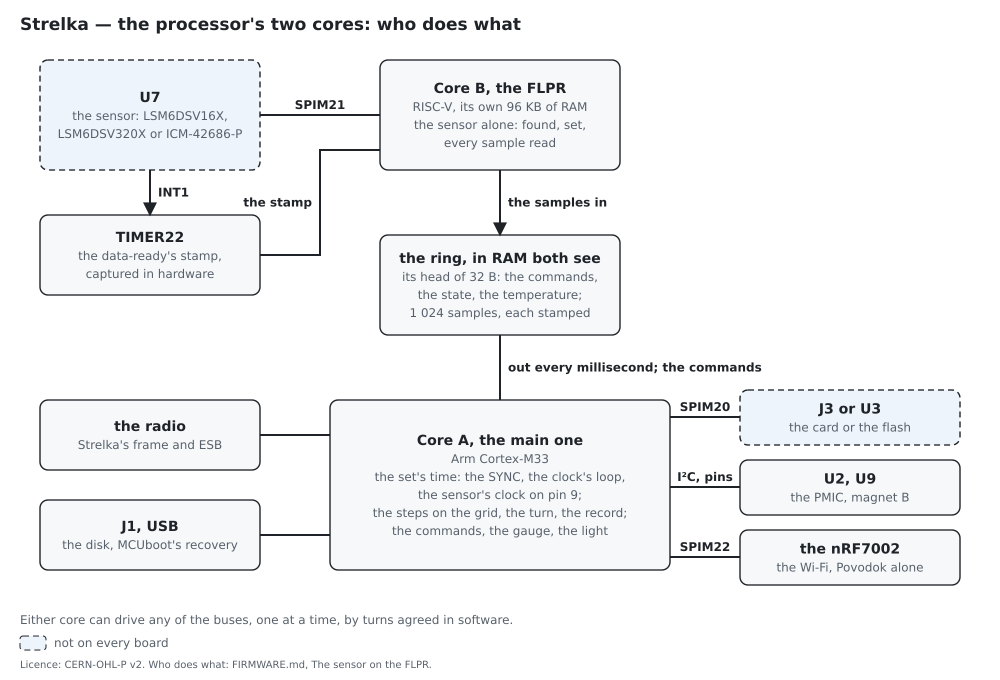

# The firmware

**What the Belka's, Kryska's and Povodok's firmware do, each on its own.**

↑ [NIC-Strelka](README.md)

---

The Belka's and Povodok's firmware are two projects in [`firmware/`](firmware/), the FLPR's program
a third beside the Belka's: the Belka measures,
writes its card and sends; Povodok commands the set, gathers it and talks to the phone. Kryska runs
the Belka's, built for its own board ([`KRYSKA.md`](KRYSKA.md)). The radio's code — Strelka's own
frame, ESB and SMP — they share. What the units say to each other over the radio is in
[`PRINCIPLE.md`](PRINCIPLE.md), the record in [`RECORD.md`](RECORD.md), the phone in
[`PHONE.md`](PHONE.md); here is what the firmware does on its own.

## The principle — no computation in the unit

A Belka reads its sensor, stamps the samples, stores them and sends them, and nothing else. The
samples are kept as the sensor gives them, or summed N to one, N chosen per session, 1–10 — 100 Hz
as 1 kHz summed ten to one or 800 Hz eight to one, 1 kHz as 4 kHz four to one; the rate into memory
runs from 50 Hz to 32 kHz, raw from 4 kHz, N 1 there. A sum is no filter and no model — the gyro's
sum is the turn over that time, the accelerometer's the change of velocity. **A sum is stored as its
mean**, the sum divided by N, in the sensor's own 16 bits: a sample's noise, some 1–1,6 mg at 1 kHz
(70 µg/√Hz over the filter's band), is larger than the step the division loses, 0,49 mg at ±16 g and
0,98 mg at ±32 g. The file's head carries N and the ranges, so the application converts. The one
computation in a Belka is the live view's: its turn as quaternions from its accelerometer and gyro —
the gyro integrated step by step, its tilt held to gravity and its bias learned by Mahony's
complementary filter (Mahony, Hamel and Pflimlin, IEEE Transactions on Automatic Control 53(5),
2008), the heading free, no magnetometer — or the raw steps, as the session says; the record carries
none of it. No other filter, no spectrum, no measure runs in the unit; every analysis is the
application's or a computer's, from the record, so that each use takes the method it needs — the
lameness measures in [`analysis/`](analysis/) are one method among any.

## The platform

- **nRF Connect SDK**, Nordic's SDK on Zephyr, which carries the nRF54LM20A and its development
  kit from v3.1.1 and supports them from v3.3.0 — Bluetooth LE, ESB, Wi-Fi with the nRF7002,
  MCUboot's DFU, the high-speed USB — v3.4.0 with long-term support
  ([Nordic](https://nrfconnectdocs.nordicsemi.com/ncs/latest/nrf/releases_and_maturity/releases/release-notes-3.3.0.html));
  Fanstel asks v3.3.0 or newer for the BM20 series (its specification v1.00).
  The firmware is built for the **nRF54LM20-DK** as the target `nrf54lm20dk/nrf54lm20a/cpuapp`,
  the nRF54LM20A emulated on the kit's nRF54LM20B
  ([Zephyr](https://docs.zephyrproject.org/latest/boards/nordic/nrf54lm20dk/doc/index.html)),
  the same chip as the Belka's and Povodok's modules.
- **MCUboot**, the boot loader, for the images that come over the radio and over USB.
- **The Belka:** Strelka's own frame and ESB on the one radio, taking turns within the period: ESB
  started by `esb_init()` once the frame's part of the period is over and stopped by
  `esb_disable()` before the next, every period — Nordic's own way for a radio shared with a
  protocol of one's own, which keeps the timing whole in the firmware's hands
  ([Nordic DevZone](https://devzone.nordicsemi.com/f/nordic-q-a/129531/nrf54lm20a-ncs-v3-4-0-esb-only-in-the-rest-of-each-20-ms-period-esb_init-esb_disable-or-timeslot));
  the turns are in *The inside link*, below. MPSL is never started, `CONFIG_MPSL_FEM_ONLY`, so that
  it holds neither the radio nor TIMER10.
- **Povodok:** the same, and the Wi-Fi, the nRF7002, at 5 GHz, clear of the set's band; Bluetooth LE
  in its service mode alone (*The service mode*, below), to receive the network's name and password,
  at the default +5 dBm. Bluetooth LE needs MPSL whole; `bt_disable()` then uninitialises it,
  `CONFIG_BT_UNINIT_MPSL_ON_DISABLE` with `CONFIG_MPSL_DYNAMIC_INTERRUPTS`, and what MPSL held — the
  radio, TIMER10, TIMER20 and channel 0 of DPPIC10, DPPIC20, PPIB11 and PPIB21 — is free before ESB
  and the frame take the radio ("These peripherals can be used freely when MPSL is not initialized":
  nrfxlib's MPSL page, v3.4.0).
- **On the first boards:** ESB on the nRF54LM20A as the primary transmitter, and its turns with
  Strelka's frame — how long `esb_init()` and `esb_disable()` take, for which Nordic gives no
  figure, measured by a pin's toggle: the first thing tried on the development kit.
- **The SDK's MCUmgr reboot hook off on the Belka**: `MCUMGR_GRP_OS_REBOOT_BT`, on by default on the
  nRF54L series whenever MPSL is in, calls `mpsl_uninit()` before a reset, and pulls in a part of
  libmpsl that asks for MPSL's two low-latency callbacks, defined in MPSL's initialisation, which
  the FEM-only cut leaves out: the Belka's image would not link. The symbol has no prompt; the
  Belka's `Kconfig` gives it one and its `prj.conf` turns it off, Nordic's own advice
  (DevZone 129531), no patch to the SDK; MPSL never started, the Belka has nothing to take down
  before a reset. Povodok keeps it, its MPSL whole.

## The service mode

Povodok has two modes and nothing between. **The service mode** is where it is after every start:
the set is made up there — the network's name and password given over Bluetooth LE, the Belkas
searched for and taken, the set and its own number given (64/19), the passwords and the
calibrations written, the clocks brought together on the SYNCs — and nothing is recorded, the
live view off. Bluetooth LE advertises from the start until a phone has joined Povodok, on the
network or the lead, or 64/20 comes; then it goes off, MPSL with it, and the radio is the set's
(*The platform*). **At work**, from the application's 64/20 until Povodok is switched off and on,
Bluetooth LE stays off and the set records and shows its live view; whatever sets or erases is
refused with 6 — on Povodok 64/7, 64/12, 64/13, 64/15, 64/17 and 64/19, to a Belka 64/3's write,
64/5, 64/7, 64/8 and 64/9, never bridged ([`COMMANDS.md`](COMMANDS.md)). A Belka has no mode of its
own and no Bluetooth LE: it is given its set and its number once, by its cable or by Povodok over
ESB, and joins no other set until it is made to forget.

A Povodok is numbered 0–3 inside — on the air, in SMP, in its settings — and 1–4 wherever a person
reads it: on its box, in the application and in its name on the network. A Belka is 1–63 in both.

## A session

1. **Switched on.** A Belka by magnet A, held until the light shows (*The magnets and the
   light*); Povodok by its cable or by magnet A.
2. **A new Belka**, or one after the factory settings, listens on 2480 MHz and the search's
   address. The application starts the search: Povodok sends its CALLs, the Belka its HERE in its
   window; then by SMP the two agree a key by ECDH, and the Belka is given the set's key, its
   number, the set's address and channel, and moves to them.
3. **The phone** joins the first Povodok, the lowest number present, by USB or Wi-Fi — or, the set
   gathered by the network, every Povodok on one 5 GHz network; its password is checked by a
   challenge and its answer.
4. **The session** is set by SMP: the rate, N, the ranges, the live view, the seconds without a
   SYNC that stop the record; the session's number, the date and time and the time zone. Without a
   phone Povodok gives the number, and the time is the last the phone gave it, or "unknown". The
   sensors start, and with them **the warm-up**: half a minute to a minute untouched, the live
   view already showing.
5. **The calibration**, six faces, led by the application (*Calibration*, below).
6. **The set's table** goes from the application through Povodok to every Belka by SMP; each Belka
   writes it right after the head of every file.
7. **On the animal**: the live view and the set's map; nothing is recorded yet.
8. **The start.** The application, or magnet B on Povodok, sets the SYNC's state to "the record
   runs"; a Belka records from the period after the first SYNC heard saying so. The sensor already
   runs — the ICM-42686-P's gyro needs 30 ms to its drive being ready and is kept on 45 ms at
   least (DS-000639, table 1 and 14.36) — and the clock has locked, within a second of the first
   SYNC.
9. **Live**, every Belka sends its LIVE in its slot; the first Povodok gathers the set — the MISS
   and the PASSes — and passes it to the phone; or, gathered by the network, every Povodok sends
   the phone what it heard itself ([`PRINCIPLE.md`](PRINCIPLE.md), *The three ways of
   gathering*).
10. **The stop.** The SYNC says "the record does not run": a Belka stops after five such SYNCs and
    writes its file's end. Ten seconds without a SYNC are a pause alone, no end written; a SYNC
    saying the record runs takes it up again in the same session.
11. **The download**: over the radio through the first Povodok, the others joined over Wi-Fi for
    the reach; or a Belka on its cable as a disk; or the set in the dock.

## The inside link

What the units say to each other is in [`PRINCIPLE.md`](PRINCIPLE.md), *The inside link*. The
firmware adds:

- **Every send and every receive is started by a timer in hardware**, through the DPPI, no processor
  in the path; the software only makes the packet ready before. A packet whose instant has passed
  is dropped, never sent late into another's slot.
- **The SYNC's arrival is stamped by a timer in hardware**, for the clock's loop.
- **A Belka sends its LIVE in its slot in every period while awake**, once a second asleep (*The
  power*), a SYNC heard or not; after ten seconds without one it stops sending and listens.
- **During a download** the radio turns within the period between Strelka's frame and ESB; what goes
  by SMP, in which frames and how a Belka is reached through Povodok is in
  [`COMMANDS.md`](COMMANDS.md). The turns are Nordic's (*The platform*, above):
- **The frame hands ESB a clean radio**: its SHORTS, its interrupts and its PUBLISH and SUBSCRIBE
  cleared before `esb_init()`. The radio's interrupt line goes to ESB's handler at `esb_init()` and
  back to the frame's after `esb_disable()`, by `CONFIG_ESB_DYNAMIC_INTERRUPTS`.
- **Every `esb_init()` starts afresh**: it puts ESB's default addresses into the radio, so the
  addresses, the prefixes, the channel and the power are set again by ESB's setters; its FIFOs are
  empty, so the fragments not yet acknowledged are queued again from Strelka's own queue; its
  duplicate detection by the PID is reset, and the fragment's count drops a fragment taken twice
  ([`COMMANDS.md`](COMMANDS.md), *The frame over ESB*).
- **ESB stops in time**: it has no stop at a given time, and `esb_disable()` aborts a packet in
  flight, so no packet is begun later than one packet before the cutoff, the PRX stopped by
  `esb_stop_rx()` at it; a packet cut off goes again in the next period. ESB stopped so before
  `esb_disable()` is Nordic's answer for ESB halting on the nRF54L15 with acknowledgements
  ([Nordic DevZone](https://devzone.nordicsemi.com/f/nordic-q-a/129303/cannot-get-any-form-of-esb-to-work-on-the-nrf54l15-soc-and-nrf54l15-dk));
  in v3.4.0 `esb_disable()` suspends ESB itself first, and `esb_stop_rx()` is the PRX's alone, a
  PTX's returning `-EPERM` (`nrf/subsys/esb/esb.c`).
- **The peripherals**: TIMER10 is ESB's while it runs, reprogrammed for every packet, so the period
  and the stamps run on TIMER22 (*The sensor and its clock*), and the frame may take TIMER10 after
  `esb_disable()`. ESB takes its DPPI channels, DPPIC10's and EGU10's 6–8, through `nrfx_gppi` in
  `esb_init()` and frees them in `esb_disable()`; the firmware's own channels are taken through
  `nrfx_gppi` too, so that the two never meet.

<!-- calc:esb-turns -->
In a download's period ESB has from the SYNCs' end, 582 µs, to its cutoff 500 µs before the next
period: 18 918 µs, 15 packets of 1 188 µs, none begun in the last 1 188 µs before the cutoff; the
1 098 µs left over are what `esb_init()` may take before a packet is lost. ESB's `retransmit_delay`
is 1 200 µs, above one packet with its acknowledgement.
<!-- /calc -->

## The sensor and its clock

- **Pin 9, the common time**, is made by a timer of the 16 MHz peripheral clock on a pin: on the
  ICM-42686-P or -42688-P CLKIN, 32 kHz; on the LSM6DSV16X the reference of
  its ODR-triggered mode, a rising edge at the start of every even period of the set, 40 ms,
  640 000 ticks — the shortest reference AN5763 allows from 200 Hz up (Rev 4, 3.3, table 15) —
  its ODRsel the nearest of that table within ±33 % of the rate, 800 Hz for 1 kHz, and
  ODR_TRIG_N_ODR half the samples in 40 ms, 20 for 1 kHz, the register counting in twos. The
  sensor's data-ready pin is captured by another timer in hardware. A PI loop lengthens or shortens
  CLKIN's period by a tick, or the reference's by the ticks it asks — the loop and its figures in
  [`PRINCIPLE.md`](PRINCIPLE.md).
- **The 32 MHz crystal runs for as long as the unit keeps the set's time**, never let go between
  the radio's turns: without a request the 16 MHz peripheral clock runs on the internal
  oscillator, −10 to +6 % (nRF54LM20A datasheet v1.0, 5.4.1 and 11.4.1), and CLKIN would fall
  below the sensor's 31 kHz (DS-000639, table 8). The firmware holds the crystal itself;
  `CONFIG_ESB_CLOCK_INIT` is left off, so that ESB does not handle the clocks at all, and the
  firmware applies for as long what ESB would apply with its clock, the nRF54LM20A's errata 20
  and 39: Constant Latency mode and the PLL kept running (the SDK's
  `nrf/subsys/esb/esb_workarounds.c`). The crystal draws 34–63 µA by its size (11.10.1).
- **The set's grid is the first Povodok's timer**: period p's SYNC leaves at its period 0 plus p
  times 20 ms, to the tick, the send started in hardware; the software only wakes 2 ms before to
  make it ready, on a work queue of its own above every thread, so that no other work holds it
  back. A receiver's delay from the packet's end to its END event is measured on the kit and
  taken out once, and what wanders in it from period to period is measured there too.
- **The fallback**, should the sensor not bear a period a tick longer: CLKIN or the reference
  straight, every period the same, and the samples put onto the grid by the application from the
  offsets in the information blocks.
- **The hoof's LSM6DSV320X takes no common time on pin 9**: its 320 g channel asks the
  high-performance or high-accuracy mode and has no ODR-triggered one (DS14623 Rev 3, 6.1.2 and
  table 21). It runs on its own clock at an ODR at least 1,9 times the rate on the grid — 480 Hz
  for 200, 960 for 500, 1 920 for 1 000, 3 840 for 2 000, 7 680 for 4 000 (table 54) — pin 9 left
  alone, and every sample, stamped in hardware as any, is drawn onto the set's grid: each point of
  the grid between two samples takes the straight line between them at its instant, the set's
  period 0 taken again at every SYNC, `firmware/common/resample.c`; across a gap of more than two
  and a half of the sensor's periods, a lost sample's, nothing is drawn and the grid's points
  there are marked lost. The steps after it are the same as from a steered sensor; the head's
  clock byte says 2 ([`RECORD.md`](RECORD.md)). The line's error on a sine sampled 1,9 times over
  its grid is at most A ω² h² / 8: 1,3 % of A at a tenth of the grid's rate, 0,08 % at a fortieth.
- **The LSMs and the ICM-42686-P** share one land, not their registers: the firmware reads 0x75
  first — 0x44 the ICM-42686-P's WHO_AM_I (DS-000639, 14.58), 0x47 the ICM-42688-P's, an option
  (DS-000347, 14.58), 0x00 on an LSM, its Z_OFS_USR after reset (DS13510, the register map) — then
  0x0F, 0x70 the LSM6DSV16X's WHO_AM_I (9.13), 0x73 the LSM6DSV320X's (DS14623 Rev 3, the register
  map); and it offers the phone the ranges that chip has, ±16 g, ±32 g, or on the LSM6DSV320X ±16
  to ±320 g, a range above 16 g taken from its high-g channel; ±4 000 °/s, or ±2 000 on the
  ICM-42688-P. The record's head carries the accelerometer's and the gyro's full scales as the
  chip's step makes them, the step times 32 768 — 341 g at the LSM6DSV320X's ±320 g — so that
  every tool turns the steps by one rule ([`RECORD.md`](RECORD.md); the steps in
  [`PARTS.md`](PARTS.md)).
- **The sensor's pins at reset.** The LSMs' INT1 and INT2 wake as outputs forced to ground
  (DS13510, table 23; DS14623, table 25): the data-ready is captured once it is routed to INT1, and
  on the LSM6DSV16X the reference is driven only once the ODR-triggered mode is set, in power-down
  as the sheet asks (6.6); on the LSM6DSV320X pin 9 is never driven. The
  ICM-42686-P's INT1 and pin 9 wake as open-drain outputs, active low
  (INT_CONFIG, reset 0x00), so the data-ready is set push-pull and active high before it is
  captured, and CLKIN is driven only once the sensor is set to take it — RTC_MODE in INTF_CONFIG1
  and PIN9_FUNCTION in INTF_CONFIG5 (DS-000639, 12.7); INT_ASYNC_RESET
  in INT_CONFIG1 is cleared as well, as the sheet asks, and the pulse set to 8 µs with no
  de-assert hold, which the sheet requires at 4 kHz and above (INT_TPULSE_DURATION,
  INT_TDEASSERT_DISABLE).

## Reading the sensor

- **The FLPR reads every sample**, at every rate and of every sensor: the chip's RISC-V
  coprocessor waits for each data-ready's stamp, captured in TIMER22 in hardware, reads that
  sample's 14 B in one burst over SPI at 8 MHz, some 20 µs — from TEMP_DATA1 at 0x1D through the
  gyro's z on an ICM (DS-000639, the register map), from OUT_TEMP_L at 0x20 through the
  accelerometer's z on an LSM (DS13510, the register map), through the high-g channel's z at 0x39
  on the LSM6DSV320X with that channel on, 26 B (DS14623 Rev 3) — and lays it with its stamp in
  RAM shared with the main core, which builds the blocks and writes the card: one core reads, the
  other writes and sends (*The sensor on the FLPR*, below). The bus bears 32 kHz — 14 B at 8 MHz
  take 14 µs of every 31 µs — and every sample keeps its own stamp; a sample the FLPR passes is
  counted, and seen in the record as a step dropped. The SDK, v3.4, carries the FLPR of the
  nRF54LM20A as experimental (its `vpr_flpr.rst`); Nordic's own sample `accel_polling` reads a
  motion sensor over SPI21 from it.
- **The LSM6DSV16X's rates** are 200, 500, 1 000, 2 000 and 4 000 Hz, each with its ODRsel within
  ±33 % and its samples a reference of 40 ms, above the least for that ODRsel (AN5763 Rev 4, 3.3,
  table 15) — 4 kHz the most its ODR-triggered mode reaches, ODRsel 3 200 Hz + 33 % (DT0155 Rev
  2) — its accelerometer's data-ready on INT1, pulsed; its own band, ODR/2 with LPF2 off (DS13510
  Rev 4, table 69). Its outputs are little-endian, and its temperature 256 a degree, 0 at 25 °C
  (table 4). Its axes are the ICM's on the shared land, so either sensor's x, y, z go into the
  record as they come, nothing remapped ([`BOARD.md`](BOARD.md), *U7*).
- **The fallback**, should the FLPR not prove itself on the kit, built with
  `belka/boards/sensor_on_app.overlay` and `CONFIG_STRELKA_SENSOR_FLPR=n`
  ([`firmware/README.md`](firmware/README.md)): the main core reads the registers
  at every data-ready, its stamp taken in the data-ready's interrupt and queued; the registers
  hold the newest sample alone, so a reader lagging a sample behind pairs a stamp with the sample
  after it — counted, and seen in the record as a repeated step dropped. At an ICM's raw rates,
  4–32 kHz, the sensor's FIFO, 2 048 B (DS-000639, 6.3), emptied in bursts every millisecond by a
  timer, the data-ready captured in hardware all the while, its interrupt off; the temperature
  from each packet's one byte, 64 times the register's scale (DS-000639, 6.1 and 14.6).
- **Every sample by its number on the set's grid.** A sample's data-ready stamp, against period 0,
  gives its number — the samples stand on the grid, steered there, so the nearest grid point is
  theirs; in a FIFO's burst the newest is numbered by its stamp and the rest counted back, their
  offsets in the information block counted with them. Step k of the record sums the N samples
  numbered from the first sample of the period the record began in, plus k × N: every Belka's step
  k the same N instants, whenever its sensor began. A sample lost leaves its step the mean of the
  rest; a step lost is marked, its six values −32 768, and counted in its block's steps missing
  ([`RECORD.md`](RECORD.md)).

## The sensor on the FLPR

The sensor is the FLPR's alone; the main core keeps the radio, the clock and the card. Two
programs, built apart and signed as one image (*The firmware's own updates*): `firmware/flpr`,
built for `nrf54lm20dk/nrf54lm20a/cpuflpr`, and the Belka's, whose `src/sensor_flpr.c` answers
the sensor's calls from the ring. In the picture the main core is A and the FLPR B. Between two
data-readies the FLPR idles, woken by the data-ready's own interrupt, so that the core does not
run at its 128 MHz for the whole session: which line wakes it — GPIOTE20's second interrupt line
on the data-ready's channel, or the VPR's event interface — the kit settles, and until then its
loop polls the stamp ([`firmware/README.md`](firmware/README.md)).

| | the FLPR | the main core |
|---|---|---|
| the sensor | SPIM21 and the sensor: set, read, its temperature | — |
| the samples | waits for each data-ready's stamp in TIMER22, reads the sample, lays it in the ring | empties the ring every millisecond into the steps and the blocks |
| the rest | nothing: no interrupt of its own, no GPIOTE | the radio, the SYNC, the clock's loop, pin 9 and its timer, TIMER22, the card, the commands, USB |

**The ring** lies in RAM both see, 32 B of head and 1 024 samples of 16 B, 32 ms at 32 kHz,
`common/sensor_ring.h`; neither core writes the other's fields. The head:

| bytes | field | written by |
|---|---|---|
| 0 | the state: 0 not set, 1 set and pin 9 may run, 2 measuring, 3 a fault | the FLPR |
| 1 | the sensor: its WHO_AM_I, 0x70, 0x73, 0x44 or 0x47, 0 none; 0xFF not yet looked for | the FLPR |
| 2 | the command: 0 none, 1 set, 2 start, 3 stop | the main core |
| 3 | the command's number u8, one up with each | the main core |
| 4 | the number of the last command done | the FLPR |
| 5 | the temperature i8, in ½ °C from 25 °C, −39 to +88,5 °C | the FLPR |
| 6–7 | the sensor's rate u16, Hz | the main core |
| 8 | free, zero: the range is at 22–23 | — |
| 9 | the gyro's range u8, ±°/s / 125: 2 ±250 to 32 ±4 000 | the main core |
| 10–11 | the samples lost u16, the ring full | the FLPR |
| 12–15 | the samples written u32 | the FLPR |
| 16–19 | the samples read u32 | the main core |
| 20–21 | the samples passed u16, a stamp more than a sample after the last | the FLPR |
| 22–23 | the accelerometer's range u16, ±g: up to 320 on the hoof's sensor | the main core |
| 24–31 | free | — |

A sample: the data-ready's stamp u32, TIMER22's ticks of 16 MHz, made 64-bit by the main core
against its own count, the timer wrapping every 268 s; the accelerometer's x, y, z i16; the
gyro's x, y, z i16, as the sensor gives them. Half a degree is enough for the gyro's bias as the
unit warms, 0,003 °/s against the LSM6DSV16X's ±0,006 °/s a degree (DS13510 Rev 4, table 3).

**The order**, which keeps the sensors' rule for pin 9 (*The sensor and its clock*): the main core
clears the head before the FLPR runs — Nordic's launcher starts it at POST_KERNEL; the FLPR finds
the sensor and writes its byte last; the main core writes the ranges and the rate and command 1;
the FLPR sets the sensor and answers state 1; the main core starts pin 9, then command 2; the FLPR
turns the sensor on and answers state 2. A command is done when its number comes back in byte 4.

**The memory**, as Nordic's guide lays it out (the SDK's `nrf54l_signing_with_payload.rst`): the
FLPR's code in a partition inside the first image slot, 0xE0000–0xF8000, as large as the 96 KB of
RAM it is copied into, which the launcher asks; the slot's end, 0xF8000–0x102000, left for
MCUboot's swap. The RAM in its two parts, since a running FLPR lengthens
the main core's accesses to RAM_01, from 0x20040000, its own taking turns with them (the SDK's
`vpr_flpr.rst`; the nRF54LM20A's datasheet, the memory map):

| RAM | from–to | what | whose |
|---|---|---|---|
| RAM_00, 256 KB | 0x20000000–0x20040000 | the main core's program: its data, stacks, the radio's and USB's buffers — what is in use, `firmware/README.md` | core A |
| RAM_01 | 0x20040000–0x20060000 | the card's buffer, 128 KB | shared: whichever core holds the card |
| | 0x20060000–0x20063800 | spare, 14 KB | — |
| | 0x20063800–0x20067C00 | the ring, 17 KB | shared |
| | 0x20067C00–0x2007FC00 | the FLPR's code and data, 96 KB — 28 KB in use | core B |

The card's buffer lies where both see it, so that the card could change hands without anything moved
(*Either core on any bus*, below); the card asks 1 MB/s of a RAM that gives some 500 MB/s, 32 bits
at 128 MHz, and a byte every microsecond at 8 Mbit/s, so a wait on the bus, in cycles of 7,8 ns, is
nothing to it. What wants an answer within cycles — USB's buffers at 480 Mbit/s, the radio's, the
interrupts' stacks — stays in RAM_00. `belka/boards/flpr.overlay` and the FLPR's own overlay hold
it; the fallback keeps the same map.

**Either core on any bus, by turns** — a possibility kept open for trials, not the design. Both
cores reach every SPIM, TWIM and pin of the peripheral domain: Nordic's
own sensor shield drives SPIM21 on the same pins from either core, as it is built (the SDK's
`pca63565` shield, its overlays for `cpuapp` and `cpuflpr`). One at a time, since a bus's registers
are the same for both: the core giving a bus finishes its transfer, lets the device go — Zephyr's
`device_deinit`, which its SPIM driver has — and says so in a field of its own; the other takes it
by `device_init`, the device marked `zephyr,deferred-init` in its devicetree so that neither core
takes it at the start. The FLPR has no atomic instructions (RV32EMC), so no lock both write: each
core writes its own field alone, as in the ring's head. What it would mean for each bus:

- **the sensor's**, SPIM21: either core, as now with the fallback;
- **the card's**, SPIM20: handed over between a record and a download alone, which never run
  together — its file system closed on one core and opened on the other; Zephyr's driver for a
  card over SPI has no release of its own, so the card's turn wants a change there. Its buffer
  already lies in RAM both see, and the FLPR with the sensor, the steps, the record's blocks,
  FatFs and the card's driver weighed 65 KB of its 96 in a trial build;
- **the Wi-Fi's**, SPIM22 on Povodok: core A's, its driver and the network's stack asking far more
  RAM than the FLPR has, and its bus wanted the whole time the Wi-Fi is up. Povodok's own FLPR is
  free for whatever is tried there.

## The pins

The pins are the nRF54LM20A's, from its datasheet v1.0: the pin table (10.1.6, table 83), the
clock pins marked there, the rules that a peripheral uses the pins of its own power domain and a
serial peripheral the pins of one port (10.1; 8.9), and the ports' speeds (table 41); the
module's pads that carry them from the BM20 series' specification, version 1.00, the pin table;
the board's nets from [`BOARD.md`](BOARD.md). On the development kit none of them is taken by its
debugger, its buttons, its LEDs or its crystal (the kit's guide v0.7.0, tables 1–4 and 10).

**Every unit:**

| signal | the nRF54LM20A | the module's pad | why there |
|---|---|---|---|
| the PMIC's SCL, SDA | P0.04, P0.03 | C2, E7 | TWIM30 in the low-power domain; SCL on a clock pin; R8 and R9 on the board |
| the PMIC's interrupt, PMIC_INT | P0.00 | A5 | an input from the PMIC's GPIO0; wakes the chip from System OFF |
| magnet B | P0.02 | A6 | an input, the processor's own pull-up on it; wakes the chip from System OFF |
| USB: D+, D−, VBUS | dedicated | G7, G6, H7 | the contact's pair; VBUS from the PMIC's VBUSOUT (8.27.1) |
| SWDIO, SWDCLK, nRESET | dedicated | J3, K3, G2 | Tag-Connect's pads inside the box |

Magnet A and the light are the PMIC's, not the processor's: magnet A on its SHPHLD, the light on
its LED0 and LED1 (*The PMIC*).

**The Belka and Kryska**, the BM20F and the BM20M:

| signal | the nRF54LM20A | the module's pad | why there |
|---|---|---|---|
| the sensor's SCK | P3.04 | C3 | SPIM21 in the peripheral domain, on a clock pin; P3 runs at 8 MHz at most, the sensor read at 8 MHz |
| the sensor's SDI, the processor's SDO | P3.05 | H2 | SPIM21 |
| the sensor's SDO, the processor's SDI | P3.07 | C9 | SPIM21 |
| the sensor's CS | P3.02 | D7 | SPIM21; R11 holds it high until the processor runs |
| the sensor's data-ready, INT1 | P3.01 | E6 | GPIOTE20, which serves P1 and P3 (the instances' table), to a timer of the same domain, captured in hardware |
| CLKIN, to the sensor's pin 9 | P3.00 | K5 | made by a timer of the same domain through GPIOTE20 |
| the Belka's card: CLK, DI, DO, CS | P3.03, P3.08, P3.09, P3.10 | A7, D4, K7, K2 | SPIM20 in the peripheral domain, CLK on P3's other clock pin; the card's identification at 400 kHz, then 8 Mbit/s (11.19.1) |
| the Belka's card's supply, U6's EN | P3.06 | D8 | an output; U6 holds it low by 500 kΩ until it is driven |
| Kryska's flash: CLK, DI, DO, CS | P3.03, P3.08, P3.09, P3.10 | A7, D4, K7, K2 | SPIM20, the card's pins, at 8 Mbit/s; R25 holds CS high until the processor runs |

P1.04–P1.14 are free on the BM20F and the BM20M and given a pull.

**Povodok alone**, the WM02C20C, its nRF7002 on pins inside the module, as Fanstel's example
wires it (the BM20C series' specification, the pin table and its Wi-Fi overlay):

| signal | the nRF54LM20A | why there |
|---|---|---|
| the Wi-Fi's MOSI, MISO, SCK, CS | P1.06, P1.07, P1.11, P1.10 | SPIM22 in the peripheral domain, 8 MHz; P1.11 wired inside the module, its pad not connected (Fanstel's answer, 3 Nov 2026) |
| the Wi-Fi's IRQ, BUCK-EN | P1.14, P1.04 | the nRF7002's interrupt and its buck |
| the Wi-Fi's IOVDD | P1.05 | the module's TCK127BG, the Wi-Fi off at 3 nA |
| coexistence: status 0, request, grant, status 1 | P1.08, P1.09, P1.12, P1.13 | the radio and the Wi-Fi sharing the air |

The kit's own Wi-Fi shield, the nRF7002-EB II, sits on other pins of the nRF54LM20 DK, so the
module's overlay repins it to these — the nRF54L15 DK's pinout, which Fanstel copied.

The sensor's and the card's pins, P3.00–P3.10, are free on Povodok's board and given a pull.

- **The 32 MHz crystal's load capacitance is set to 14,5 pF** in the chip, Fanstel's setting
  for ±20 ppm on the carrier from −40 to 105 °C (the series' specification, *Crystal*); the
  development kit keeps its own 15 pF. The module's 32,768 kHz crystal is never started.
- **Left free:** every other GPIO, given a pull. **Left unconnected:** P1.01 and P1.02, the NFC
  pins from reset (8.9.1).
- **The SYNC's arrival** is an event of the radio's domain; it reaches TIMER22, the peripheral
  domain's free timer and the one timer of the set's time, through the DPPI's bridge, PPIB11 to
  PPIB21, with a delay the datasheet does not promise constant across the domains (6.1). Nordic's
  answer (DevZone 129531): the route takes some 250 to 500 ns, the domains' synchronisers adding 1
  to 2 cycles of variation, some 125 ns at 16 MHz, within the loop's 0,5 µs — so long as the
  peripheral domain is kept clocked while the SYNC is awaited, a wake-up adding microseconds:
  **Constant Latency mode is held** for as long as the crystal is, on every chip. TIMER10, in the
  radio's own domain, would need no bridge, but ESB takes it again at every turn, and a common start
  for it and TIMER22 would cross the bridge all the same; TIMER22 alone keeps the time. The kit
  measures the delay, the loop takes out its mean, and the kit tells which of the SYNC's events
  varies least — its END, captured now, its ADDRESS or the initial sync, EVENTS_SYNC, which Nordic
  names. The capture keeps off what MPSL holds while it runs, TIMER10, TIMER20 and channel 0 of
  DPPIC10, DPPIC20, PPIB11 and PPIB21 (nrfxlib's MPSL page, v3.4.0), and off ESB's, TIMER10 and the
  channels it takes through `nrfx_gppi`; its own channels come through `nrfx_gppi` as well (*The
  inside link*).

## The record

The record on the card is [`RECORD.md`](RECORD.md): files on FAT32 or exFAT, blocks of 512 B, each
ending in a CRC-32. The firmware adds:

- **FatFs in Zephyr**; a session a file, its room taken in one run at the start, so that the
  record runs into free clusters in a row: FatFs's `f_expand`, which Zephyr's file API reaches by
  `CONFIG_FS_FATFS_EXTRA_NATIVE_API`. The room asked is a day of the record at its rate, or the
  card's free room if less, under 4 GiB on FAT32, FatFs's limit there; where no such run is
  free, a quarter of it twice more, each try that fails reading the whole FAT on FAT32; then none,
  the file growing as it goes. While the file is open its room not yet written counts as free; at
  the end the file is cut to its last byte written, FatFs's `f_truncate`; one cluster of the card
  is left free, so that the end has its block when the card fills. A file stops under 2 GiB,
  Zephyr's file offsets being 32 bits, and the record goes on in its next part,
  `S00007B03_2.STRK`, `_3` and on, each part begun with the session's head again, so that each
  reads on its own and the application joins them by the blocks' numbers. What is written is saved
  every 3 s, so that a power cut loses 3 s at most; at the next start the Belka cuts a file left
  so, the room still its own, to its last block of its own, read back by its session
  ([`RECORD.md`](RECORD.md), *The end*).
- **Through a buffer of 128 KB in RAM.** The sensor's side puts each finished block into it at
  once, and a writer of its own, below the sensor and the radio, takes the blocks onto the card in
  their order, so that neither the sensor nor the radio ever waits for the card. Should the buffer
  fill all the same — the card busy longer than it bears — a block is dropped, never one written
  late; the blocks dropped are counted in the file's end and in the Belka's state.
- **The CRC-32 by the main core**, some 30 µs a block: 512 B at some 8 cycles a byte of a
  table's CRC, at 128 MHz — an estimate, timed on the kit.
- **The card full**: the record ends, its end saying *the card full* — the end itself written where
  the card still has a block for it — and the light shows a fault.
- **The card erased or formatted** only by the application's command, at the user's word, asked
  again; refused while the Belka records. Nothing else deletes anything.
- **The list of sessions** is read from the card's directory; the Belka keeps none of its own.
- **Kryska's record goes raw onto its flash**, the same blocks, into room erased beforehand, each
  session after the last, the memory erased whole by 64/5; its sessions are files of a file
  system of its own, so that the download and the list are the Belka's
  ([`KRYSKA.md`](KRYSKA.md), *The record on the flash*).

## Calibration

- **Six faces after the warm-up**, led by the application: from the live view it computes, and
  writes into each Belka by SMP, the raw readings — the accelerometer with each axis up and down,
  the gyro's scale from the turns between the positions, the gyro's zero at rest, warm, the
  temperature and the time. The Belka keeps them across power-ons and puts them into the head of
  every file ([`RECORD.md`](RECORD.md), *The session's head*); it computes nothing itself.
- **The warming on the animal.** The gyro's zero moves with temperature; the sensor's temperature is
  in every information block, and the application follows the zero by it.
- **The conversion is the application's.**

## USB — the unit on the cable

On the cable a unit shows to the computer over the contact's pair at high speed, 480 Mbit/s:

- **A Belka is a disk**: its card as it is, with its sessions' files; Kryska has no disk yet, its
  sessions and its set going by SMP on its serial port (below; [`KRYSKA.md`](KRYSKA.md), *The
  record on the flash*). The Belka is switched on by its magnet, and the disk shows only while
  it does not record, the Belka letting its file system
  go to the host for that time and taking it back when a record begins, the disk gone from the
  host then; the card's bus sets the pace, some 1 MB/s. **In a set the disk is read-only**: the
  Belka tells the host so, and refuses every write that comes all the same, so that no computer
  touches the records — the card is erased by the application's command alone. Zephyr's disk class
  does neither by itself; a patch to it kept with the firmware (`firmware/patches/`) asks the
  Belka at every write. The disk is opened for writing, until the cable leaves, by **magnet B held
  3 s** on the Belka on its cable, the hand on the unit its key, or by the application's **64/5
  `do` 3**, which, as the card's erasing and formatting and the forgetting, passes only right after
  the lock written again, the password given again for each ([`COMMANDS.md`](COMMANDS.md), *The
  lock*); the light orange for 2 s, and the disk comes down and up, so that the host mounts it
  anew. A Belka in no set, new or after its factory settings, has its disk open, for its
  `STRELKA.SET` (*What a unit keeps*).
- **Povodok is a network adapter**, USB's CDC-NCM, and TCP/IP runs over it to the application as it
  does over Wi-Fi ([`PHONE.md`](PHONE.md)).
- **Both have a serial port**, the console on the bench and the door of MCUboot's serial recovery,
  in the SDK over USB from v3.3.0 (`CONFIG_BOOT_SERIAL_CDC_ACM`): with VBUS present at power-on —
  the chip's VBUS detector says so — MCUboot brings the port up and listens three seconds for a
  command, a firmware image coming in through it; without VBUS it boots at once. The SDK's own wait
  is unconditional (`BOOT_SERIAL_WAIT_FOR_DFU`) and has no hook, so the VBUS condition is a patch to
  it kept with the firmware (`firmware/patches/`); and the USB driver's own wait for VBUS, which the
  SDK leaves unbounded, is bounded, so that neither MCUboot nor the application can stand still
  without a cable. A unit sealed in its box takes its firmware so, through the contact. A phone
  offers no serial port to an application, so for it the network adapter alone counts
  ([`PHONE.md`](PHONE.md)). **On Kryska the port carries SMP as well**, in Zephyr's SMP over
  console framing beside the console's lines, which a client passes over: the download by 8/0,
  and the set as `STRELKA.SET` written by 8/0's upload where a Belka's disk would be open
  ([`COMMANDS.md`](COMMANDS.md)); no lock on the cable, whoever holds the cable holding the unit,
  as whoever holds a magnet does.

The USB block runs only while VBUS is present (8.27.1); off the cable it is dark and costs nothing.

## The power

A Belka is in one of three states of power, the link deciding period by period
(`firmware/common/belka_link.c`, its rules in `link_rules.h`):

- **Awake** — recording, or the live view on: as the pages say elsewhere, the sensor read at every
  data-ready, a SYNC heard every period, the LIVE in its slot.
- **Asleep** — the live view off, nothing recorded, a SYNC heard in the last period listened, no
  move said: the radio wakes in the state's period alone, once a second, a SYNC heard and the
  state sent, the minute's items among them; between, the sensor stopped, the card's supply off,
  the crystal let go and the processor idle. Some 22–45 µA, months on the cell
  ([`PRINCIPLE.md`](PRINCIPLE.md), *The current*). A frame bridged to a Belka asleep waits in
  Povodok for her state's period and goes then, within the 3 s the port allows
  ([`COMMANDS.md`](COMMANDS.md), *A Belka through Povodok*). The live view switched on wakes it
  within a second, the sensor's warm-up after it; a SYNC missed wakes it too, every period
  listened until
  one is heard. A set laid out on the table, its Povodoks on, waits so, and the light shows by its
  blink which Belkas found their set. Nordic's figure holds with the DC/DC regulator enabled: left
  off, the nRF54LM20A's idle has been measured at some 89 µA, not 4 (DevZone 126766).
- **Off by itself** — every Povodok gone: with no SYNC heard for 64/1's `off`, 10 minutes by
  default, a Belka not recording goes off, into ship mode; one recording, paused after its ten
  seconds, after three times as long, 30 minutes, its end written, "the set silent"
  ([`RECORD.md`](RECORD.md)). A set switched off at its Povodoks switches itself off after them.

## The PMIC — the charge, the off and the gauge

The PMIC, Nordic's nPM1300, on Kryska the nPM1304 or the nPM1300 ([`BOARD.md`](BOARD.md), *U2*) —
the nPM1304's run built with its own devicetree, the SDK's drivers encoding its charge otherwise —
runs on the SDK's own drivers: the MFD `nordic,npm1300`, its charger as a sensor and its regulators'
node, the LEDs written through the MFD's registers, on TWIM30 at 400 kHz, address 0x6B, its
interrupt from its GPIO0 to P0.00 (`host-int-gpios`, `pmic-int-pin`). What the firmware sets is in
each unit's devicetree; the PMIC keeps none of it through its own reset, so every start writes it
again. A PMIC that does not answer at the start leaves the unit on, as on the development kit,
which has none, with the fault *the PMIC silent* in its state ([`PRINCIPLE.md`](PRINCIPLE.md));
its light and magnet A, both the PMIC's, are dead then, and the PMIC's own 10 s on magnet A, its
hardware alone, is the rescue if the PMIC itself runs.

- **The charge**, the charger's node, the cell kept between some 20 and 80 % where its chemistry
  lets it, LiFePO4 at 3,50 V at the most, Li-ion and Li-poly at some 80 % by their curves: **the
  Belka** 3,50 V and 300 mA, the LFP103042's standard charge under its 360 mA; **Kryska** the
  cell's chosen with its box, a tenth of its capacity an hour, 4,00 V for Li-poly or 3,50 V for
  LiFePO4, the build's 4,00 V and 32 mA until then;
  **Povodok** 4,00 V, some 80 % of a Li-ion cell, the build's 200 mA until its cell is chosen. On
  every board the cell's NTC of 10 kΩ, B 3 380 K between 25 and 50 °C (the nPM1300's product
  specification v1.1, table 12); no charge under 0 °C, half the current up to 10 °C, the full one to
  45 °C, the same end voltage from 40 °C, none above; the cell feeding up to 1 A, on the nPM1304 its
  fixed 125 mA; **the USB input raised to 500 mA** on the Belka and Kryska, **to 1,5 A** on Povodok,
  a ceiling, its draw itself — the Wi-Fi's peaks, some 290 mA, and the charge — within a computer
  port's 500 mA of USB 2.0 — the firmware raises it at every start, VBUSINILIM0 with
  TASKUPDATEILIMSW, and the driver writes it as the startup limit, VBUSINILIMSTARTUP, so that a
  cable plugged in again keeps it (6.1.8). The charger is enabled at every start, `charging-enable`;
  off from the PMIC's power-on until then, so that a firmware that never runs leaves its cell
  uncharged, never overcharged.
- **The off is ship mode**, 370 nA: the cell parted from the board, by the SDK's
  `regulator_parent_ship_mode()` on the PMIC's regulators, which writes TASKENTERSHIPMODE. The
  firmware enters it once the cable is out — with the cable in, the PMIC is not to be put there
  until VBUS has gone (7.4) — and magnet A held 96 ms or the cable brings the unit back, the
  board started as from power-on. Should the PMIC not take it, the processor still running a
  second later ten times over, the processor goes into its own System OFF, the cell then feeding
  the board's quiescent draw; a cable come in meanwhile restarts the unit into its idle.
- **A restart keeps a unit on.** Off the cable, a soft reset — an update's swap, a set given, the
  factory settings — the watchdog's, a lockup's, the reset pin's or a debugger's leaves the unit on,
  as the reset's cause says (Zephyr's hwinfo); only a start from ship mode asks for magnet A or the
  cable. The two restarts a unit makes on purpose otherwise — switched off on the cable, and after
  the factory settings — say so by a mark in GPREGRET[1], a register kept through a soft reset and
  through MCUboot. The watchdog runs on through a soft reset (the nRF54LM20A's datasheet v1.0,
  table 22): MCUboot feeds it, and the firmware too until its own is installed, for the first minute
  of the start at the most, so that a start that hangs is still reset; the idle on the cable and the
  tries at ship mode feed it from their own loops. Its settings hold with it: started once, its
  registers locked while it runs, a timeout changed in a new firmware takes effect only after ship
  mode or the cell parted, never by a soft reset. The PMIC is not reset with the processor: what
  the last run left pending among its events is cleared at the start, so that PMIC_INT is not held
  high.
- **The cable wakes every unit**, VBUS taking the PMIC out of ship mode. **A Belka or Kryska
  woken by the cable alone**, magnet A not held at its start, is not switched on: it shows the
  cell's state as a short hold of A does, then idles on the cable's power — the radio, the sensor,
  the card or the flash and USB off, the processor idle, the gauge read every second — its light
  the PMIC's, green while it charges; magnet A held then switches it on, and when the cable
  leaves, the PMIC's VBUS-removed event on PMIC_INT takes it back into ship mode. **Povodok woken
  by the cable is switched on**, as by magnet A, and shows on the computer's USB; when the cable
  leaves it runs on its cell and goes off 5 min later, unless the cable has come back. **Switched
  off while the cable is in** — magnet A's hold or the application's *off* — a unit idles dark,
  its light the PMIC's, magnet A its one wake, and goes into ship mode when the cable leaves; on
  Povodok a cable put back starts it. A port that keeps its 5 V with the computer off neither
  starts nor stops it.
- **Magnet A through the PMIC**: its hold and its release are the PMIC's events on PMIC_INT,
  `NPM13XX_EVENT_SHIPHOLD_PRESS` and `NPM13XX_EVENT_SHIPHOLD_RELEASE`, and at the start the
  firmware reads whether it is held from SHPHLDSTATUS, 0x0B05, bit 0 low while it is (7.4.2.6).
  A low held 10 s power-cycles the board, the PMIC's own long press (tRESETBUT, 7.5), left on as
  reset: the rescue of a unit whose firmware hangs in its glued box.
- **The light from the PMIC**: the red on LED0, the green on LED1. From the PMIC's reset LED0
  shows the charger's error and LED1 its charge, with no firmware (LEDDRV0MODESEL,
  LEDDRV1MODESEL); the firmware takes both into the host's mode, LEDDRVnSET and CLR, for its own
  patterns, and gives them back to the charger whenever the cable is in and it shows nothing of
  its own — not recording, not sought, no fault. Each colour lit sinks 5 mA.
- **The gauge**: Nordic's nRF Fuel Gauge, nrfxlib's library for a secondary cell
  (`CONFIG_NRF_FUEL_GAUGE`), fed every second with the cell's voltage, current and temperature
  from the PMIC's charger as a sensor, and told the charger's state and the cable's, as the SDK's
  sample `npm13xx_fuel_gauge` does. Its state is kept on the way into ship mode and given back at
  the start (*What a unit keeps*), so that the charge counted holds across the off, where the
  cell gives only the board's 2 µA. **The cell's model** is made from the cell itself on the
  bench, by Nordic's nPM PowerUP (the nPM1300's product specification, 7.1.7), which profiles a
  cell to the end voltages of LiFePO4, 3,50–3,65 V, since its v1.3.0 (its changelog); until then
  the build carries the SDK sample's model, a Li-ion cell's, which reads a LiFePO4 cell wrongly.
- **The cell empty**: under its end voltage for ten seconds running — 3,10 V on the Belka's
  LiFePO4 ([`PARTS.md`](PARTS.md), *The cells*), 3,30 V on Kryska's and Povodok's until their cells
  are chosen, `CONFIG_STRELKA_CELL_EMPTY_MV` — the record is closed, its end saying *the cell low*,
  and the unit goes off. The gauge's 0 % is not trusted for it, even with the cell's own model:
  "LFP cells have a relatively flat OCV curve", the gauge on them "still possible with reduced
  accuracy", no figure given (Nordic's
  [FAQ](https://devzone.nordicsemi.com/nordic/nordic-blog/b/blog/posts/frequently-asked-questions-for-the-npm1300-and-npm1304)).

## The magnets and the light

No button: two magnets and the two-coloured light, red and green, both lit at once for orange.
Magnet A, at its mark on the box, switches the unit on through its Hall switch on the PMIC's
SHPHLD, out of ship mode ([`BOARD.md`](BOARD.md), *U2*), and the processor reads it through the
PMIC while the unit runs; magnet B,
at the box's other end, is read while the unit runs. A hold acts when it is let go, by how long
it was held, so that a hold of 6 s does not stop at 3 s; while both magnets are held, neither's
own hold counts. The holds and the lights are fixed, the same on every unit and on the box's
label.

| magnet A | what it does |
|---|---|
| off, put on | the PMIC leaves ship mode once the magnet has been there 96 ms, and the board starts; the firmware, once it runs — some 0,3 s, and 3 s more on a cable, while MCUboot waits for a command — keeps it on while the magnet is still there, and goes back into ship mode if it has gone: a magnet brushed past does nothing |
| off, held until the light shows | on |
| on, a short hold | shows the cell's state, below |
| on, held 6 s | off, when let go: the record closed, the unit into ship mode, dark as the magnet leaves |
| held 10 s, the unit on or off | the PMIC cuts the board's power and starts it again by itself, the firmware not asked: the rescue of a unit that hangs in its glued box ([`BOARD.md`](BOARD.md), *U2*); the magnet still there, the unit comes on |

| magnet B | what it does |
|---|---|
| on Povodok, the set in preparation, held 3 s | the set starts measuring; the light green for 2 s |
| on Povodok, the set measuring, held 6 s | the set stops; the light red for 2 s |
| on a Belka on its cable, not recording, held 3 s | its disk opened for writing until the cable leaves (*USB*); the light orange for 2 s |

A hold of B between 3 and 6 s starts, between 6 and 10 s stops, each only in its own state; on a
Belka magnet B alone does that only.

| both magnets | what they do |
|---|---|
| held together 8 s, the unit on or off | the factory settings, made at 8 s — with the unit off, counted from magnet A's coming, as near as the start allows — before the PMIC's own restart at 10 s: the light orange for 2 s, the set forgotten, the settings back to their first values, the calibration and the gauge's state forgotten, the records kept, the unit started again; held on past 10 s, the PMIC restarts the board as well, and both still there 8 s more make the settings once more, nothing more lost |

The factory settings also by the application's command, which asks the user again.

| a short hold of A shows | the cell, of its capacity |
|---|---|
| green, four blinks | 76–100 % |
| orange, three blinks | 51–75 % |
| orange, two blinks | 26–50 % |
| red, one blink | 11–25 % |
| red, fast blinks | 10 % and less |

| the light | means |
|---|---|
| green, slow blinks | in a set, waiting |
| green, fast blinks | measuring |
| green and red in turn | Povodok |
| red blinks | the cell is low, under 20 % |
| green steady, on the cable | charging, lit by the PMIC itself |
| dark, on the cable | charged, or the charge waiting on the cell's temperature |
| red steady, on the cable | the charger's fault, lit by the PMIC itself |
| red steady | a fault |
| orange, fast blinks | sought by the application, *blink* ([`COMMANDS.md`](COMMANDS.md)) |

In a set the set's light comes first; on the cable outside a set the PMIC shows the charge. With
the unit off the light is the PMIC's alone, on the cable: green while it charges, red for the
charger's fault, else dark.

## What a unit keeps

Across power-ons, in Zephyr's settings on ZMS in the storage partition, under `strelka/`, one home
for every unit, `firmware/shared/store.c`:

| key | what | written |
|---|---|---|
| `set` | the set's address, channel and key | given by the cable — a Belka's `STRELKA.SET`, a Kryska's the same file by SMP on its serial port, a Povodok's 64/19 — or at the taking over the radio (64/9); the channel again as the set moves, the latest once a minute at most, so that a unit switched on later finds the set where it went — on an older one it finds it by the sweep it makes when it hears no SYNC ([`PRINCIPLE.md`](PRINCIPLE.md), *The inside link*) |
| `n` | the unit's number: a Belka's 1–63, 0 a new one; a Povodok's 0–3 | at the taking, or with the set given by the cable |
| `cal` | a Belka's calibration, the head's fields (`RECORD.md`) | by 64/3 |
| `gauge` | the fuel gauge's state, as its library gives it (`nrf_fuel_gauge_state_get`) | on the way into ship mode, and once an hour (*The PMIC*) |
| `pw` | Povodok's: the application's password's SHA-256 | by 64/17; none kept, the build's own |
| `label` | Povodok's: the set's own number, 1–9999, the user's; none, none shown | with the set, by 64/19 |

They lie plain in the storage partition, the set's key, the password's hash and Povodok's Wi-Fi
password with them (Zephyr's Wi-Fi credentials, beside these): whoever holds a unit and a debugger
reads them. A unit built for others has its debug port locked, `CONFIG_NRF_APPROTECT_LOCK` and
`CONFIG_NRF_SECURE_APPROTECT_LOCK`, which the development builds here leave open, as Zephyr's
default for the nRF54L does.

**The set given by the cable**, the way a set is made up on the
table: the application draws the set — its address, 4 B, so that sets in their cases or stables
side by side never mix; its key, 16 B; its channel — and gives it to every unit, the number with
it, 1–63 a Belka's, 0–3 a Povodok's, which the user may write on its box:

- **to a Belka**, a short text file on its disk while the host has it, `STRELKA.SET` —
  `set = A1B2C3D4`, `channel = 7`, `key =` 32 hex digits, `number = 5`
  (`firmware/common/setfile.h`, `tools/strelka_set.py`), written by the application or by hand
  on a phone or a computer, no driver asked, on a new Belka's disk or one opened (*USB*); the
  Belka takes it as it has its card back, the
  cable gone or at its start — reads it, keeps it, overwrites its bytes and deletes the file — and
  its light shows green 2 s, or red 2 s for a file refused — one over 512 B among them;
- **to a Kryska**, which has no disk, the same file written by SMP on its serial port, 8/0's
  upload into its record's file system ([`KRYSKA.md`](KRYSKA.md), *The record on the flash*),
  taken at once as from a disk — allowed on a new Kryska, or one opened by magnet B held 3 s or
  by 64/5 `do` 3, as a Belka's disk is; by a computer, a phone having no serial port;
- **to a Povodok**, 64/19 over its own link, USB or Wi-Fi, under a fresh lock of its own as the
  password's change is, the key sealed with that lock's secret; it keeps it and starts again.

A Belka given its set so is in the set as soon as Povodok hears its LIVE on the set's address; no
taking is asked. A Belka after its factory settings is also taken over the radio as before, on
the search's channel and address that every set shares (*The inside link*); either way the set
is made once, and after it a set switched on finds itself, its lights saying which unit did.

Povodok's Wi-Fi name and password are kept by Zephyr's own Wi-Fi credentials, beside them; the
fragments' counts over ESB come with SMP over ESB (`COMMANDS.md`, *The frame over ESB*). **The
factory settings**, both magnets held 8 s or 64/7, delete every key above and Povodok's network,
and keep the records; the unit starts again as from the factory.

## The firmware's own updates

MCUboot keeps two images and boots only one signed by its maker. A new one comes from the
application by SMP over TCP to Povodok, and from Povodok by ESB to every Belka, Zephyr's MCUmgr
protocol ([Zephyr](https://docs.zephyrproject.org/latest/services/device_mgmt/mcumgr.html)); a Belka
writes it into the second slot and swaps at its next start when it is whole and its signature holds.
Povodok takes its own straight over TCP. The Belka's image carries both its programs, the main
core's and the FLPR's, merged and signed as one by `firmware/flpr/merge.py`, so that one update
brings both and MCUboot's signature covers both. Each image carries its version, its project's
`VERSION` file, held to `protocol.h`'s by `tools/test_firmware.py`. The first image goes
in over SWD, through the pads inside the box, before it is closed; after that MCUboot's serial
recovery takes one through the contact's USB port as well (*USB*, above).

## The code

The firmware is written in [`firmware/`](firmware/): two nRF Connect SDK projects on Zephyr, the
Belka and Povodok, sharing the radio's code and the protocol's, MCUboot beside them, and the
Belka's FLPR program, `firmware/flpr`; Kryska is the Belka's project built with Kryska's own
devicetree and configuration. Every packet,
block, header and fragment is one header, `firmware/common/protocol.h`, its sizes asserted; the
protocol's code and the record's are plain C, compiled on the host and run by
[`tools/test_firmware.py`](tools/test_firmware.py), which holds the record the C writes byte for
byte to the one [`tools/strelka_record.py`](tools/strelka_record.py) builds — the reader of the
record, which also writes CSV; [`tools/strelka_c3d.py`](tools/strelka_c3d.py) turns it into C3D,
lining up one session's Belkas by the period's number, its files read back by two readers, the c3d
package and ezc3d. The three build against the SDK, v3.4.0,
with MCUboot; nothing has run on hardware. What is written, what is not, and what the kit decides
first is in [`firmware/README.md`](firmware/README.md).
