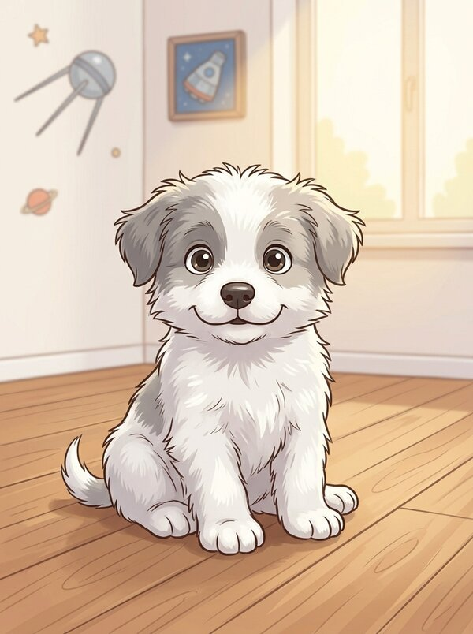
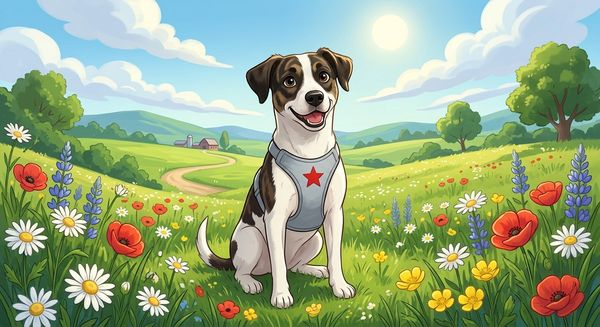
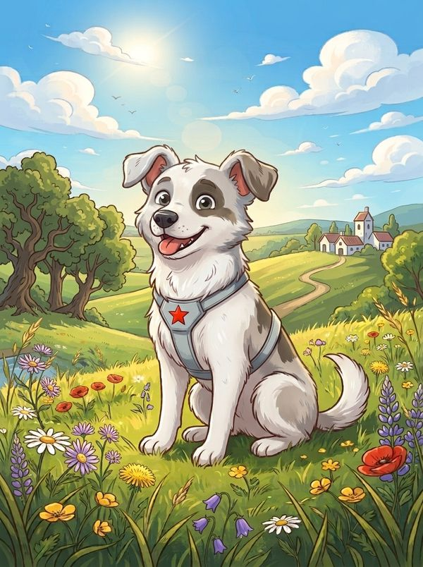
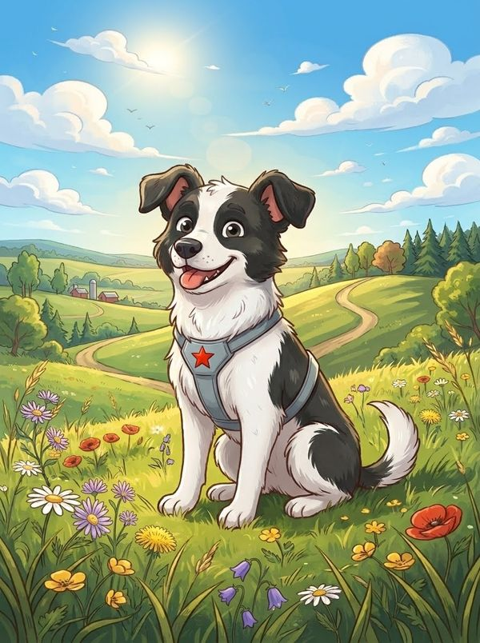
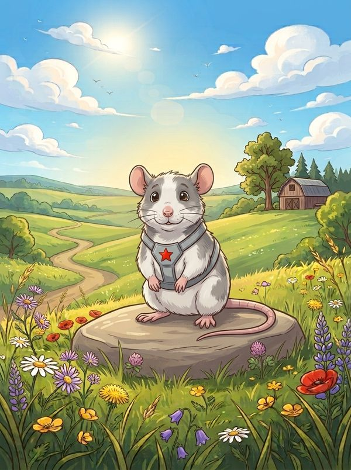
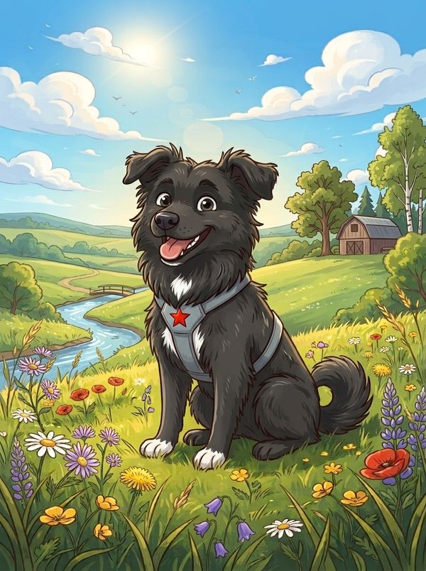
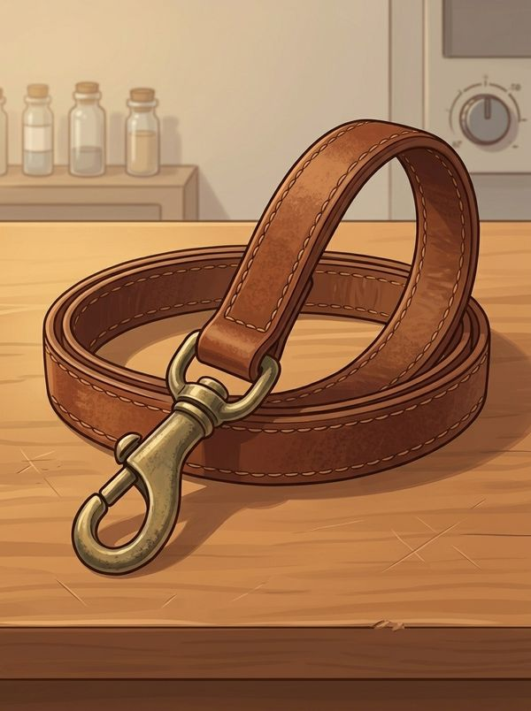
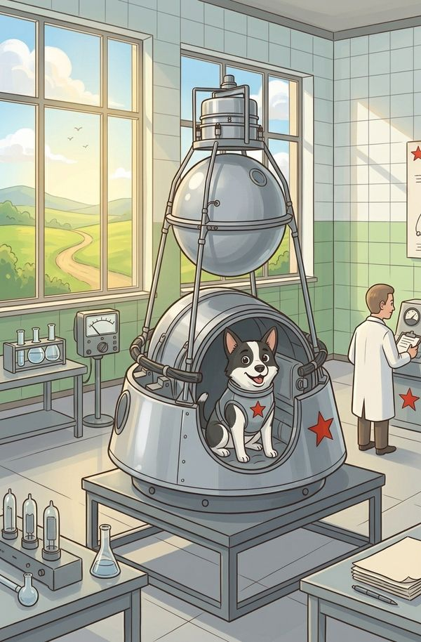
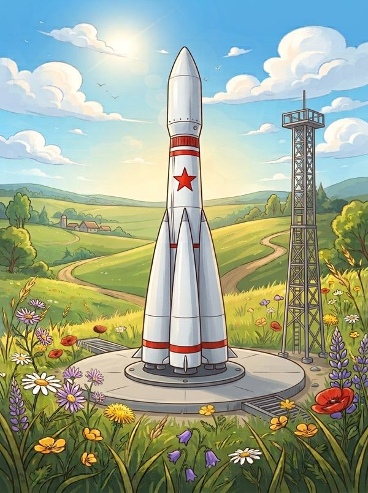
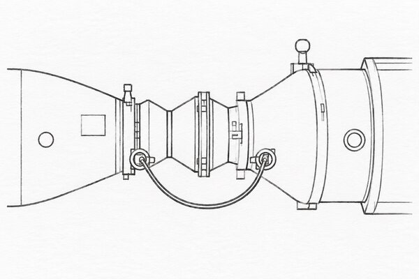

# Names

**Why the dogs.**

↑ [NIC-Strelka](README.md)

---

Strelka and Belka flew on Korabl-Sputnik 2 on 19 August 1960 and were the first to come back
alive from orbit; Pušinka was one of Strelka's puppies, given to the Kennedys
([Wikipedia](https://en.wikipedia.org/wiki/Belka_and_Strelka)); the other dogs flew too and came
back ([Wikipedia](https://en.wikipedia.org/wiki/Soviet_space_dogs)). The rest of the names are
Russian words, written in Latin letters the Czech way. The names are a joke and nothing more.

<table align="center"><tr>
<td align="center"> Strelka</td>
<td align="center"> Pušinka</td>
<td align="center"> Belka</td>
<td align="center"> Zvjozdočka</td>
<td align="center"> Ugoljok</td>
</tr><tr>
<td align="center"> Kryska</td>
<td align="center"> Černuška</td>
<td align="center"> Povodok</td>
<td align="center"> Korabl</td>
<td align="center"> Semjorka</td>
<td align="center"> Stykovka</td>
</tr></table>

| name | meaning | why |
|---|---|---|
| **Strelka** | the dog, "little arrow" | the project: the units ride on an animal, as she rode on the rocket. The project's name only, no part carries it |
| [**Belka**](PARTS.md) | the dog, "squirrel" | the unit on the animal: there are many of them, as there were two dogs |
| [**Pušinka**](APP.md) | Strelka's puppy, "fluffy" | the application on the vet's phone, the smallest of the family |
| **Povodok** | a leash | the set's commander, a box of its own: it talks to the Belkas on the radio and to the phone or the computer by a USB lead or Wi-Fi, as a leash runs between the dog and its owner's hand |
| **Korabl** | the ship, as Korabl-Sputnik 2 carried Belka, Strelka and the two rats | the box of a unit, each of its own size: the sealed case, its window for the light, its fastening |
| [**Materinka**](BOARD.md) | the motherboard, in Russian slang | the base board every unit is built on: one core drawn the same, each unit its own — the Belka's, Kryska's and Povodok's |
| **Semjorka** | the R-7 rocket's nickname, "the seven" ([Wikipedia](https://en.wikipedia.org/wiki/R-7_Semyorka)) | the case that carries a whole set, as the rocket carried the ship |
| **Ugoljok** | the dog, "little ember" | the Belka for large shocks, on the hoof: its sensor the LSM6DSV320X, its Korabl built sturdier, of a laminate or the like |
| **Zvjozdočka** | the dog, "little star", the last to fly before Gagarin ([Wikipedia](https://en.wikipedia.org/wiki/Korabl-Sputnik_5)) | the Belka for industry: its sensor TDK's ICM-42686-P, raw data up to 32 kHz |
| [**Kryska**](KRYSKA.md) | "little rat", for the two rats that flew with Belka and Strelka | the small Belka, for small animals: the board as small as can be, its memory on the board, built sturdy as standard |
| **Stykovka** | docking | whatever a unit docks onto, the magnetic contact on a lead or a station for the set: named as a spacecraft's docking, for the joining it is, the charge and USB going through it |
| **Černuška** | the dog, "blackie" | Povodok's simulator, `tools/povodok_sim.py` |
