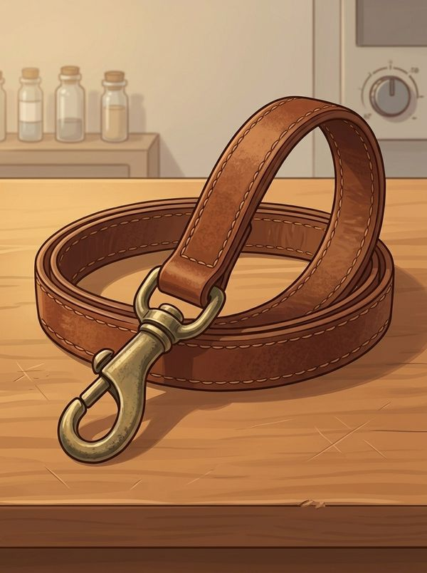
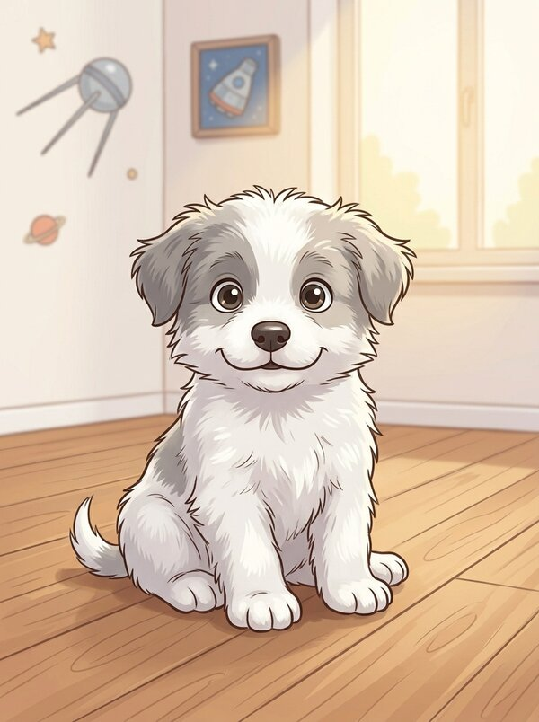
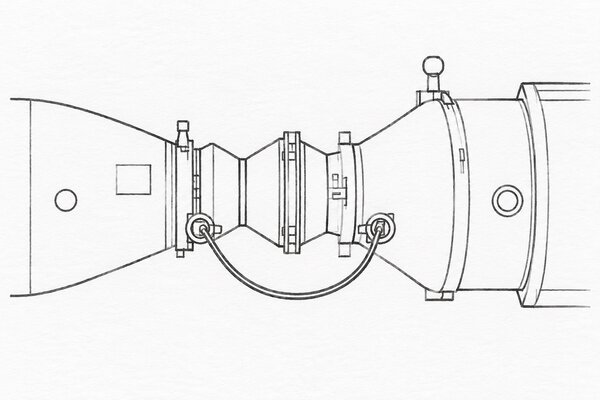
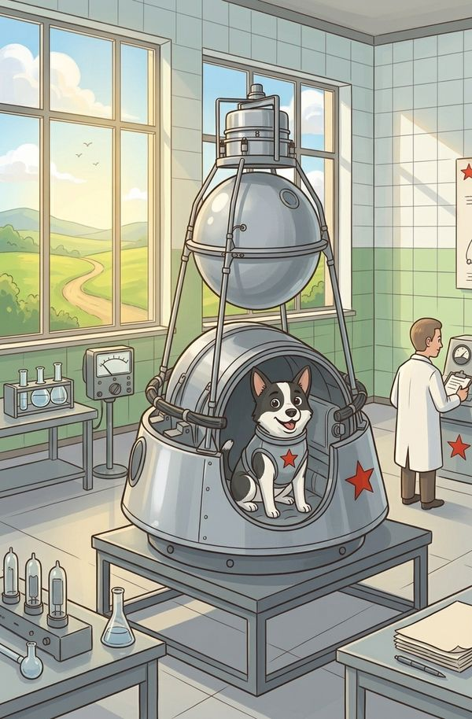
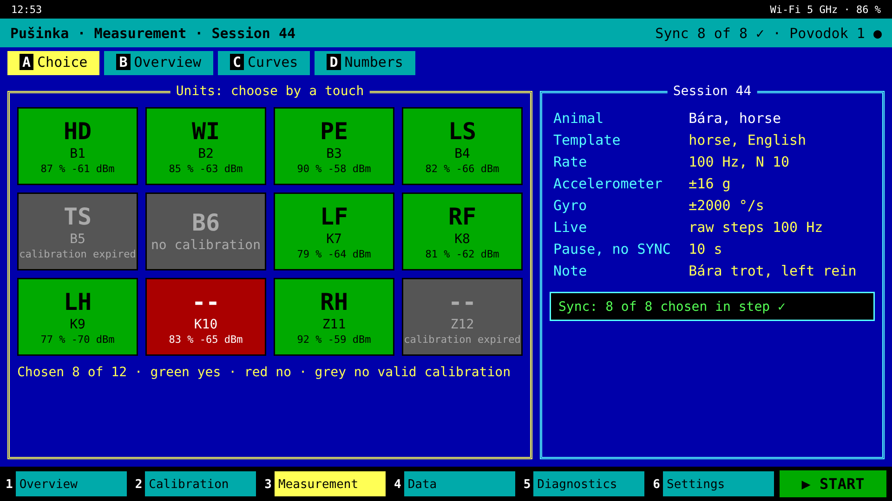
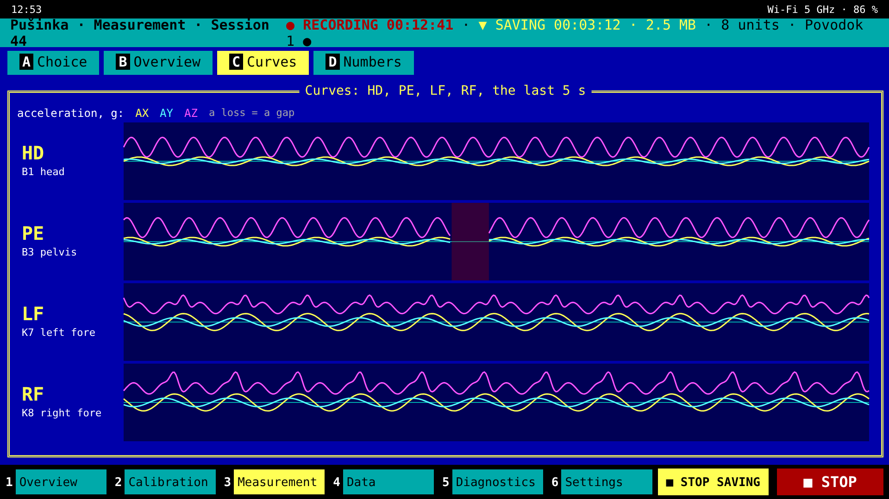
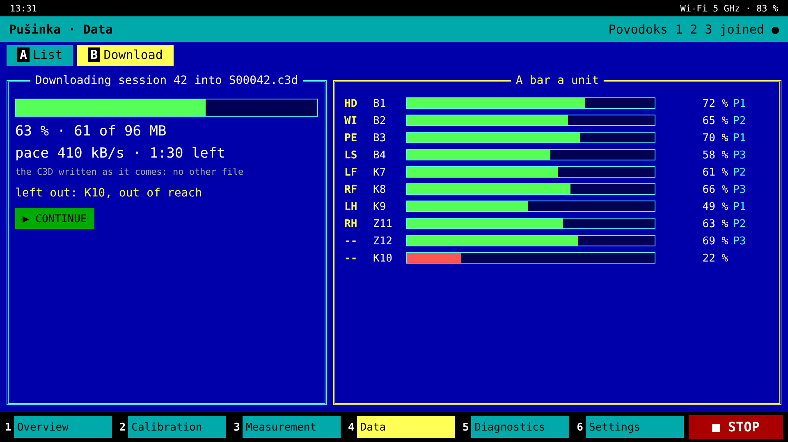

<div align="center">


# NIC-Strelka

**English** · [Čeština](README.cs.md) · [Русский](README.ru.md)

**The motion of an animal, for a veterinary examination:** small units fastened on the legs,
the trunk and the head of a dog, a horse or a cow record how it moves, every unit on one common
time, so that each leg, the trunk and the head can be laid side by side, step by step. Live on the
vet's phone wherever the radio reaches, and the whole record afterwards.

**To replace the cheap sensor sets sold today** — at their price or below if it can be, better in
any case.

</div>

> **Beta 0.86:** a design on paper, the boards described for drawing, each unit on its own — the
> Belka, [Kryska](KRYSKA.md), the small Belka, and Povodok — the firmware built against the SDK for
> each, ESB's turns by Nordic's way, the application's base in Flutter with its six menus, the
> calibration computed by the Belka itself; nothing has run on hardware yet. The drawn boards come
> with 0.9. What is closed, what is open and what only a built unit can tell is under
> [Status](STATUS.md). No tags and no releases, on purpose: the repository holds one commit, the
> latest version, replaced as the work goes on.

> **The radio rules — read before switching on.** Strelka transmits on 2.4 GHz, and Povodok on
> 5 GHz Wi-Fi as a client: set the access point it joins to your country and to 5 GHz. The Czech
> Republic's and the EU's rules, quoted, are in [`REGULATIONS.md`](REGULATIONS.md); elsewhere the
> national office's.

---

## What it is

A set of identical units, one to thirty-two, fastened on the animal by hook and loop, on a strap
or a hoof boot. Each carries a motion sensor, a radio with its processor, a card for the whole
examination and a cell for fifteen minutes at least. One to four Povodoks round the animal give
the set its time and pass what it measures to the phone or the computer.

**Everything on the animal:** no camera, no walkway. **One set for any animal**, fitted by the
number of units it carries. **Only the motion:** Strelka does not track where the animal goes.

## The parts

| part | what it is |
|---|---|
| <br/>[**Belka**](PARTS.md) | the unit fastened on the animal, with its sensor and its card, on its own base board, [Materinka](BOARD.md), whose core every unit shares. Ugoljok, a Belka for large shocks on the hoof with the LSM6DSV320X to ±320 g in a sturdier box, is described but not made: whoever needs it builds it |
| <br/>[**Zvjozdočka**](PARTS.md) | the Belka for industry, with the ICM-42686-P's raw data up to 32 kHz: for machines in a hall, a set of its own with its own Povodok |
| <br/>[**Povodok**](BOARD.md#povodok) | the set's commander, one to four in a set for the reach: it sends the time, gathers what the phone asks for and passes it on, by USB or Wi-Fi; its own Materinka with the Wi-Fi module, neither sensor nor card — its board in [`BOARD.md`](BOARD.md#povodok), its firmware in [`FIRMWARE.md`](FIRMWARE.md), its link to the phone in [`PHONE.md`](PHONE.md) |
| <br/>[**Kryska**](KRYSKA.md) | the small Belka, for small animals and the ordinary examinations: its memory on its board, built sturdy as standard |
| <br/>[**Pušinka**](APP.md) | the application on the vet's phone or a computer; its base in [`app/`](app/) |
| <br/>[**Stykovka**](PARTS.md#the-inlet) | part of the hardware: the five-pin magnetic contact, Promax's NC2347-05B on the cable against the NF2347-05B in the unit's lid, on a lead or on a station for the whole set with a USB hub, the station not designed yet. It serves the charge and USB to a computer alone, a computer copying every unit at once |
| <br/>**Korabl** | the box of a unit, each of its own size: the sealed case, its window for the light, its fastening |
| <br/>**Semjorka** | the case that carries a whole set |

Why the dogs, and what the names mean, is under [Names](NAMES.md).

**Pušinka's screens, sketched** — an idea, not the finished look; every one in
[`APP.md`](APP.md), *The menus*:

<table align="center"><tr>
<td align="center"><br/>
the measurement: the units chosen</td>
<td align="center"><br/>
the live view's curves</td>
<td align="center"><br/>
the download into one C3D</td>
</tr></table>

## Where to find what

The pages are in English.

| page | what |
|---|---|
| **Start here** | |
| [`STATUS.md`](STATUS.md) | what is closed, what is open, what only a built unit can tell |
| [`NAMES.md`](NAMES.md) | the dogs, and what the names mean; every part drawn |
| **For the vet and the user** | |
| [`APP.md`](APP.md) | what Pušinka, the application, does: its six menus, the calibration, the live view |
| [`app/mockups/`](app/mockups/) | Pušinka's screens sketched, a picture a screen |
| [`ANALYSIS.md`](ANALYSIS.md) | the lameness measures, a first skeleton after the published methods |
| [`RECORD.md`](RECORD.md) | what a Belka writes on its card, to the byte, the set's table in it |
| **The hardware** | |
| [`PARTS.md`](PARTS.md) | the parts, each with the requirement it meets |
| [`BOARD.md`](BOARD.md) | Materinka, the base boards of the three units — the schematic as nets, the values, the bill of materials |
| [`KRYSKA.md`](KRYSKA.md) | Kryska, the small Belka, for small animals |
| [`chapters/`](chapters/README.md) | closed chapters: the ways weighed, each written whole, one taken — Kryska's memory |
| [`board/`](board/) | the parts and nets as a list and as a netlist for EasyEDA; the block diagrams; the scripts that draw them |
| [`REGULATIONS.md`](REGULATIONS.md) | the radio rules, the Czech Republic's and the EU's, quoted from their texts |
| **The firmware and the radio** | |
| [`PRINCIPLE.md`](PRINCIPLE.md) | how it works: the set's rules, the radio, each block's physics and a rough calculation |
| [`FIRMWARE.md`](FIRMWARE.md) | what the Belka's and Povodok's firmware do, each on its own |
| [`firmware/`](firmware/) | the nRF Connect SDK projects of the three units, the FLPR's program, and the code they share, checked on the host |
| [`COMMANDS.md`](COMMANDS.md) | what the application, Povodok and the Belkas say to each other by SMP, to the byte |
| [`PHONE.md`](PHONE.md) | what the first Povodok and the phone say, to the byte |
| **The software and the tools** | |
| [`app/`](app/) | the application's base in Flutter: the protocol in Dart and Pušinka's six menus |
| [`tools/`](tools/) | the record's tools, to CSV and C3D; the firmware's tests; Černuška, a Povodok simulated; the set's file; the firmware's images for the application |
| [`analysis/`](analysis/) | the lameness measures' code and its checks on synthetic trots |
| [`calc/`](calc/) | the scripts behind every figure, their inputs with sources in `params.py`, and `check.py` |
| **Behind it** | |
| [`WHY.md`](WHY.md) | what was considered and set aside, and why |
| [`CONTRIBUTING.md`](CONTRIBUTING.md) | how a change comes in: the pages' form, the checks, what helps most |

## How it works

```
  Pušinka, on a phone or a computer
        │  USB on the magnetic contact, or Wi-Fi at 5 GHz:
        │  Povodok a client of a phone's hotspot, a laptop or a building's network
  Povodok 1 … 4, the leashes — the first commands
        │  Strelka's own 2.4 GHz radio: each Povodok's SYNC in a slot of its own;
        │  a Belka sends in a slot of its own, on its own clock between the SYNCs
  ┌─────┼──────┬────────┐
Belka Belka  Belka …  Belka       each hears any of the Povodoks; none relays
                                  (up to 32 units in a set)
```

- **One time for the whole set.** Each Povodok sends its SYNC every 20 ms; each Belka steers its
  sensor's clock a tick at a time until its samples fall on the set's grid, so that every unit
  samples at the same instants, to microseconds.
- **The record whole in every Belka**, on its own microSD card, in Strelka's own format written
  down to the byte ([`RECORD.md`](RECORD.md)), with converters to C3D and CSV; what the radio
  misses stays on the card. A Belka computes nothing but its turn for the live view and its
  calibration from six faces: every analysis is the application's or a computer's.
- **The live view** at 50 or 100 Hz a unit, as quaternions or the raw steps: gathered by the
  first Povodok and sent on by a USB lead or Wi-Fi, or every Povodok on one Wi-Fi network sending
  what it hears ([`PRINCIPLE.md`](PRINCIPLE.md)).
- **The lock.** The application's password is checked by a challenge and its answer and never
  crosses the lead or the air; every packet between Povodok and the Belkas, and every SYNC, is
  signed by the set's key; a firmware boots only signed by its maker.
- **The download** over the radio; or each Belka on its cable as a disk, read-only while it is in
  a set; or the whole set in a Stykovka with a USB hub, a computer copying every disk at once.
- **No button:** two magnets, A and B, and a two-coloured light — on, off, the cell's state, the
  factory settings; the measurement started and stopped by the application
  ([`FIRMWARE.md`](FIRMWARE.md), *The magnets and the light*).

The board and its parts are in [`BOARD.md`](BOARD.md) and [`PARTS.md`](PARTS.md), the firmware in
[`FIRMWARE.md`](FIRMWARE.md), the application's side to the byte in [`PHONE.md`](PHONE.md) and
[`COMMANDS.md`](COMMANDS.md).

## What exists

<details>
<summary>Systems that measure a moving animal with inertial sensors on its body: the cheap sets,
the horse's, the dog's, the cow's</summary>

- **The cheap sets — what Strelka replaces.** Wireless MPU-9250 units sold four to a set, of the
  WitMotion WT901BLECL kind: Bluetooth LE 5.0, an output of up to 200 Hz, about $48 a unit
  ([RobotShop](https://www.robotshop.com/products/witmotion-witmotion-wt901blecl-mpu9250-high-precision-9-axis-gyroscope-accelerometer-magnetometer-3-axis-bluetooth-ahrs-imu-sensor-arduino)),
  at most four at once
  ([Desertcart](https://desertcart.lk/products/511015272-bluetooth-5-0-accelerometer-inclinometer-wt-9011-dcl-mpu-9250-high-precision-9-axis-gyroscope-angle-xy-0-2-accuracy-magnetometer-with-kalman-filter-low-power-3-axis-ahrs-imu-sensor-for-arduino)).
- **Horse.** The Equinosis Lameness Locator, sold to vets: sensors on the head, the pelvis and the
  right forelimb, the data streamed to a tablet while the horse trots
  ([University of Adelaide](https://www.adelaide.edu.au/vet/ua/media/528/Client-Brochure_2019-web.pdf),
  [Horse Sport](https://horsesport.com/magazine/business/pinpointing-lameness-with-technology/)).
  EquiMoves, a research system: up to eight synchronised sensors on the poll, the withers, the
  sacrum, the sternum and each leg
  ([Bosch et al., *Sensors* 2018](https://doi.org/10.3390/s18030850)).
- **Dog.** No system sold for dogs was found. The Lameness Locator with modified software was
  tried on trotting dogs ([Stenman, SLU 2019](https://stud.epsilon.slu.se/14611/)); GaitKeeper is
  a research system ([PMC5335924](https://www.ncbi.nlm.nih.gov/pmc/articles/PMC5335924/)).
- **Cow.** Research only: accelerometers on the hind legs on four farms
  ([*Animal* 2015](https://resolve.cambridge.org/core/journals/animal/article/abs/lameness-detection-via-legmounted-accelerometers-on-dairy-cows-on-four-commercial-farms/2B43F96D169CE6C73F559435AE828915)),
  nine sensors on the body of cows with an induced forelimb lameness
  ([Leclercq et al., *Animal* 2025](https://pub.epsilon.slu.se/id/document/20449105)).

</details>

**How we know that it works:** on the same animal at the same time, Strelka shows what a system
sold to vets shows. For a horse that is such a system; for a dog and a cow, where none is sold, a
research system or the changes its published studies report.

## What it must do

<details>
<summary>1 to 32 units on any animal, about 100 Hz into memory and up to a few kHz, the live view
at 50 or 100 Hz, one time to microseconds, 15 min a charge at least</summary>

Ranges and orders of magnitude; the exact values come with the parts.

| | requirement |
|---|---|
| units in a set | 1 to 32, on one animal; the firmware holds 63; and one to four Povodoks |
| animals | a dog, a horse, a cow — the same set |
| into a unit's memory | about 100 Hz, chosen per session up to a few kHz |
| live | 50 or 100 Hz a unit, the turn as quaternions or the raw steps, chosen per session; what the radio misses is in the unit's memory |
| the units' common time | far below one sample: microseconds |
| the record | the whole examination, in every unit; a Belka's card does not limit it, Kryska's 128 MB hold some 5,5 h at 400 Hz |
| one charge | 15 min at least |
| reach | round the animal's body, up to four Povodoks round it, a Belka heard by any of them; to the phone or the computer by a USB lead or Wi-Fi at 5 GHz |
| size | a matchbox or larger |
| weight | no limit set; it follows from the parts |
| fastening | on a strap or a hoof boot, by hook and loop |
| conditions | indoors and out; water, mud and a kick; cleaned with disinfectant between animals |
| the vet's screen | a phone, Android or iPhone, or a computer |
| price | the cheap sets' or below — about $48 a unit, four to a set, before the duty and the post — and better in any case |

</details>

---

The software under the MIT licence, see [LICENSE](LICENSE); the hardware design, the pages and the
pictures, under the CERN-OHL-P v2, see [LICENSE-HW](LICENSE-HW).

## Acknowledgements

To the AI assistant Claude (Anthropic), for its great help with this project.

★ Viva La Resistánce ★
