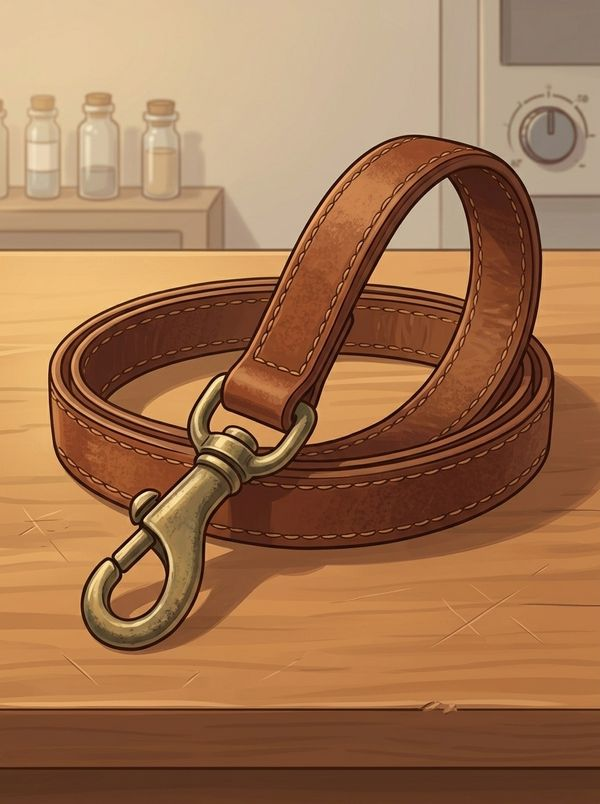
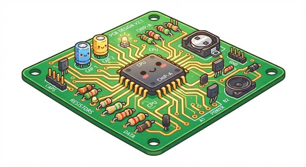
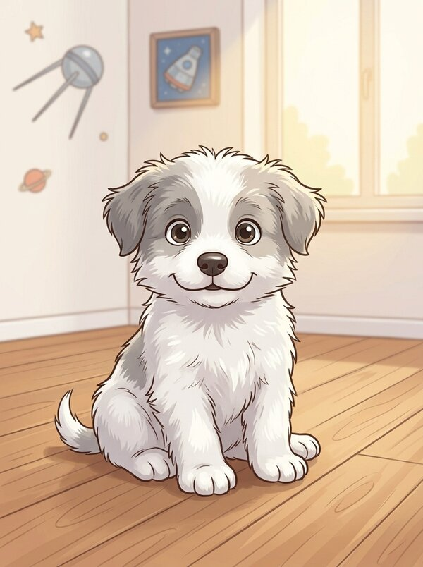
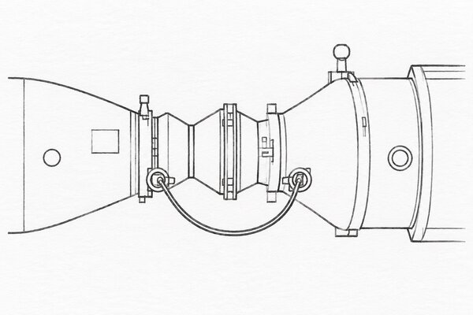
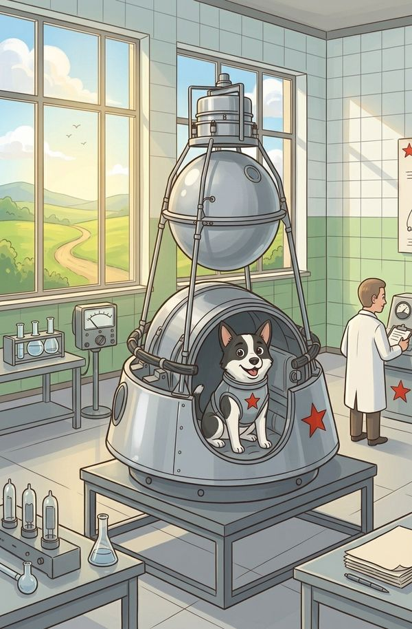
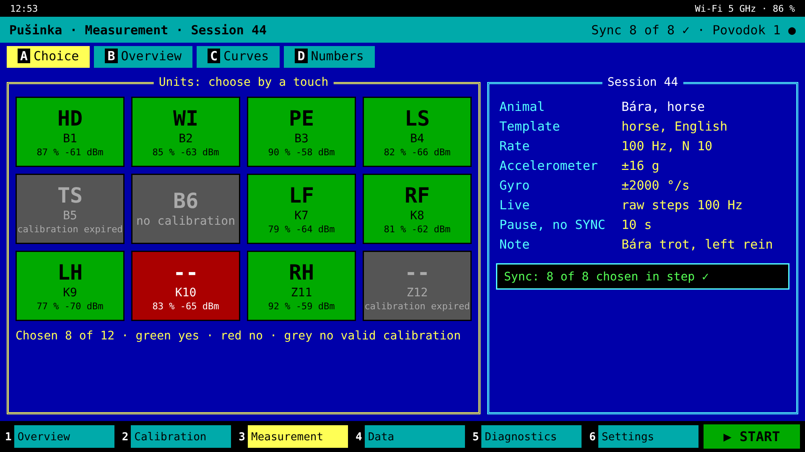
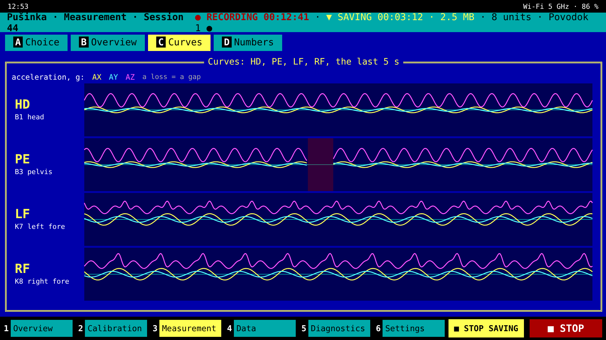
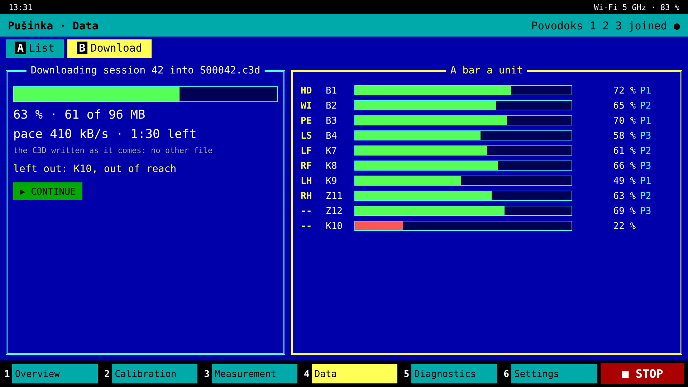

<div align="center">


# NIC-Strelka

[English](README.md) · [Čeština](README.cs.md) · **Русский**

**Движение животного для ветеринарного осмотра:** маленькие блоки, закреплённые на ногах, туловище
и голове собаки, лошади или коровы, записывают, как движется животное, каждый блок — по одному
общему времени, так что каждую ногу, туловище и голову можно положить рядом, шаг за шагом. Вживую —
на телефоне ветеринара, куда достаёт радио, а вся запись — потом.

**На замену продаваемым сегодня дешёвым наборам датчиков** — по их цене или ниже, если получится,
и в любом случае лучше.

</div>

> **Бета 0.87:** проект на бумаге, платы, описанные для рисования, каждый блок отдельно — Belka,
> [Kryska](KRYSKA.md), маленькая Belka, и Povodok, — прошивка собрана под SDK для каждого,
> чередование ESB по способу Nordic, основа приложения на Flutter с шестью меню, калибровку считает
> сама Belka; на железе ещё ничего не запускалось. Нарисованные платы придут с версией 0.9. Что
> закрыто, что открыто и что скажет только собранный блок — на странице [«Статус»](STATUS.md)
> (по-английски). Остальные страницы на английском. Тегов и релизов нет намеренно: в репозитории
> один коммит — последняя версия, заменяемая по ходу работы.

> **Правила радиосвязи — прочтите до включения.** Strelka передаёт на 2,4 ГГц, а Povodok — по Wi-Fi
> на 5 ГГц как клиент: настройте точку доступа, к которой он подключается, на свою страну и на
> 5 ГГц. Правила Чешской Республики и ЕС, в цитатах, — в [`REGULATIONS.md`](REGULATIONS.md); в
> других местах — правила национального ведомства.

---

## Что это

Набор одинаковых блоков, от одного до тридцати двух, закреплённых на животном липучкой, на ремне или
копытном башмаке. В каждом — датчик движения, радио со своим процессором, карта на весь осмотр и
аккумулятор не меньше чем на пятнадцать минут. От одного до четырёх Povodok вокруг животного дают
набору время и передают то, что он измеряет, телефону или компьютеру.

**Всё на животном:** ни камеры, ни дорожки. **Один набор для любого животного**, подстроенный
числом блоков. **Только движение:** Strelka не следит, куда идёт животное.

## Части

| часть | что это |
|---|---|
| <br/>[**Belka**](PARTS.md) | блок, закреплённый на животном, со своим датчиком и своей картой, на своей основной плате, [Materinka](BOARD.md), ядро которой общее для всех блоков. Ugoljok, Belka для сильных ударов на копыте с LSM6DSV320X до ±320 g в более прочной коробке, описан, но не делается: кому он нужен, тот его соберёт |
| <br/>[**Zvjozdočka**](PARTS.md) | Belka для промышленности, с сырыми данными ICM-42686-P до 32 кГц: для машин в цехе, отдельный набор со своим Povodok |
| <br/>[**Povodok**](BOARD.md#povodok) | командир набора, от одного до четырёх в наборе ради дальности: шлёт время, собирает то, что просит телефон, и передаёт это дальше, по USB или Wi-Fi; своя Materinka с модулем Wi-Fi, без датчика и карты — его плата в [`BOARD.md`](BOARD.md#povodok), прошивка в [`FIRMWARE.md`](FIRMWARE.md), связь с телефоном в [`PHONE.md`](PHONE.md) |
| <br/>[**Materinka**](BOARD.md) | базовая плата, на которой построен каждый блок: одно ядро, нарисованное одинаково, у каждого блока своя |
| <br/>[**Kryska**](KRYSKA.md) | маленькая Belka, для мелких животных и обычных обследований: память на своей плате, прочная уже в базовом исполнении |
| <br/>[**Pušinka**](APP.md) | приложение на телефоне ветеринара или на компьютере; его основа в [`app/`](app/) |
| <br/>[**Stykovka**](PARTS.md#the-inlet) | часть оборудования: пятиконтактный магнитный разъём, Promax NC2347-05B на кабеле против NF2347-05B в крышке блока, на кабеле или на станции для всего набора с USB-хабом, пока не спроектированной. Служит только для зарядки и USB к компьютеру, который копирует все блоки разом |
| <br/>[**Korabl**](KOROLJOV.md) | коробка блока, у каждого своего размера: герметичный корпус, его окошко для света, его крепление |
| <br/>[**Semjorka**](KOROLJOV.md) | кейс, в котором едет весь набор |
| <br/>[**Koroljov**](KOROLJOV.md) | строитель: блок и набор как конструкция — коробки Korabl, блок на теле, Stykovka и Semjorka |

Почему собаки и что значат имена — на странице [«Имена»](NAMES.md) (по-английски).

**Экраны Pušinka в эскизах** — замысел, не готовый вид; все они в
[`APP.md`](APP.md), *The menus* (по-английски):

<table align="center"><tr>
<td align="center"><br/>
измерение: выбор устройств</td>
<td align="center"><br/>
кривые живого просмотра</td>
<td align="center"><br/>
загрузка в один C3D</td>
</tr></table>

## Где что найти

Страницы на английском.

| страница | что |
|---|---|
| **Начать здесь** | |
| [`STATUS.md`](STATUS.md) | что закрыто, что открыто, что скажет только собранный блок |
| [`NAMES.md`](NAMES.md) | собаки и что значат имена; каждая часть нарисована |
| **Для ветеринара и пользователя** | |
| [`APP.md`](APP.md) | что умеет Pušinka, приложение: шесть меню, калибровка, живой просмотр |
| [`app/mockups/`](app/mockups/) | экраны Pušinka в набросках, рисунок на экран |
| [`ANALYSIS.md`](ANALYSIS.md) | меры хромоты, первый каркас по опубликованным методам |
| [`RECORD.md`](RECORD.md) | что Belka пишет на карту, до байта, с таблицей набора |
| **Железо** | |
| [`PARTS.md`](PARTS.md) | детали, каждая с требованием, которому отвечает |
| [`BOARD.md`](BOARD.md) | Materinka, базовые платы трёх блоков — схема как связи, номиналы, перечень деталей |
| [`KRYSKA.md`](KRYSKA.md) | Kryska, маленькая Belka, для мелких животных |
| [`KOROLJOV.md`](KOROLJOV.md) | Koroljov, строитель: коробки Korabl, блок на теле, Stykovka и Semjorka |
| [`chapters/`](chapters/README.md) | закрытые главы: взвешенные пути, каждый описан целиком, один выбран — память Kryska |
| [`board/`](board/) | детали и связи списком и как netlist для EasyEDA; блок-схемы; скрипты, которые их рисуют |
| [`REGULATIONS.md`](REGULATIONS.md) | правила радиосвязи Чешской Республики и ЕС, в цитатах из их текстов |
| **Прошивка и радио** | |
| [`PRINCIPLE.md`](PRINCIPLE.md) | как это работает: правила набора, радио, физика каждого блока и грубый расчёт |
| [`FIRMWARE.md`](FIRMWARE.md) | что делает прошивка Belka и Povodok, каждая сама |
| [`firmware/`](firmware/) | проекты nRF Connect SDK трёх блоков, программа FLPR и их общий код, проверенный на хосте |
| [`COMMANDS.md`](COMMANDS.md) | что говорят друг другу приложение, Povodok и Belka по SMP, до байта |
| [`PHONE.md`](PHONE.md) | что говорят первый Povodok и телефон, до байта |
| **Программы и инструменты** | |
| [`app/`](app/) | основа приложения на Flutter: протокол на Dart и шесть меню Pušinka |
| [`tools/`](tools/) | инструменты записи, в CSV и C3D; тесты прошивки; Černuška, симулированный Povodok; файл набора; образы прошивки для приложения |
| [`analysis/`](analysis/) | код мер хромоты и его проверки на синтетической рыси |
| [`calc/`](calc/) | скрипты за каждой цифрой, их входные данные с источниками в `params.py` и `check.py` |
| **За кулисами** | |
| [`WHY.md`](WHY.md) | что было рассмотрено и отложено, и почему |
| [`CONTRIBUTING.md`](CONTRIBUTING.md) | как изменение попадает внутрь: форма страниц, проверки, что помогает больше всего |

## Как это работает

```
  Pušinka, на телефоне или компьютере
        │  USB на магнитном разъёме или Wi-Fi на 5 ГГц:
        │  Povodok — клиент точки доступа телефона, ноутбука или сети здания
  Povodok 1 … 4, поводки — командует первый
        │  собственное радио Strelka на 2,4 ГГц: SYNC каждого Povodok в своём слоте;
        │  Belka передаёт в своём слоте, между SYNC — по своим часам
  ┌─────┼──────┬────────┐
Belka Belka  Belka …  Belka       каждая слышит любой Povodok; никто ничего не пересылает
                                  (до 32 блоков в наборе)
```

- **Одно время для всего набора.** Каждый Povodok шлёт свой SYNC каждые 20 мс; каждая Belka
  подстраивает часы своего датчика по одному такту, пока её отсчёты не лягут на сетку набора, так
  что все блоки берут отсчёты в одни и те же мгновения, с точностью до микросекунд.
- **Запись целиком в каждой Belka**, на её собственной карте microSD, в собственном формате Strelka,
  описанном до байта ([`RECORD.md`](RECORD.md)), с конвертерами в C3D и CSV; то, что пропустит
  радио, остаётся на карте. Belka не вычисляет ничего, кроме своего поворота для живого просмотра и
  своей калибровки по шести граням: любой анализ — дело приложения или компьютера.
- **Живой просмотр** 50 или 100 Гц на блок, в кватернионах или сырыми отсчётами: его собирает
  первый Povodok и передаёт дальше по кабелю USB или по Wi-Fi, или каждый Povodok в одной сети
  Wi-Fi шлёт то, что слышит ([`PRINCIPLE.md`](PRINCIPLE.md)).
- **Замок.** Пароль приложения проверяется вызовом и ответом и никогда не идёт по кабелю или по
  воздуху; каждый пакет между Povodok и Belka и каждый SYNC подписан ключом набора; прошивка
  запускается, только если подписана производителем.
- **Выгрузка** по радио; или каждая Belka на своём кабеле как диск, в наборе только для чтения;
  или весь набор в Stykovka с USB-хабом, компьютер копирует все диски разом.
- **Без кнопок:** два магнита, A и B, и двухцветный свет — включение, выключение, состояние
  аккумулятора, заводские настройки; измерение запускает и останавливает приложение
  ([`FIRMWARE.md`](FIRMWARE.md), *The magnets and the light*).

Плата и детали — в [`BOARD.md`](BOARD.md) и [`PARTS.md`](PARTS.md), прошивка — в
[`FIRMWARE.md`](FIRMWARE.md), сторона приложения до байта — в [`PHONE.md`](PHONE.md) и
[`COMMANDS.md`](COMMANDS.md) (по-английски).

## Что существует

<details>
<summary>Системы, которые измеряют движущееся животное инерциальными датчиками на его теле:
дешёвые наборы, для лошади, для собаки, для коровы</summary>

- **Дешёвые наборы — то, что Strelka заменяет.** Беспроводные блоки с MPU-9250, которые продают
  по четыре в наборе, вроде WitMotion WT901BLECL: Bluetooth LE 5.0, выход до 200 Гц, около 48 $
  за блок
  ([RobotShop](https://www.robotshop.com/products/witmotion-witmotion-wt901blecl-mpu9250-high-precision-9-axis-gyroscope-accelerometer-magnetometer-3-axis-bluetooth-ahrs-imu-sensor-arduino)),
  не больше четырёх одновременно
  ([Desertcart](https://desertcart.lk/products/511015272-bluetooth-5-0-accelerometer-inclinometer-wt-9011-dcl-mpu-9250-high-precision-9-axis-gyroscope-angle-xy-0-2-accuracy-magnetometer-with-kalman-filter-low-power-3-axis-ahrs-imu-sensor-for-arduino)).
- **Лошадь.** Equinosis Lameness Locator, который продают ветеринарам: датчики на голове, тазу и
  правой передней ноге, данные идут потоком на планшет, пока лошадь бежит рысью
  ([University of Adelaide](https://www.adelaide.edu.au/vet/ua/media/528/Client-Brochure_2019-web.pdf),
  [Horse Sport](https://horsesport.com/magazine/business/pinpointing-lameness-with-technology/)).
  EquiMoves, исследовательская система: до восьми синхронизированных датчиков на затылке, холке,
  крестце, грудине и каждой ноге
  ([Bosch et al., *Sensors* 2018](https://doi.org/10.3390/s18030850)).
- **Собака.** Системы, продаваемой для собак, не найдено. Lameness Locator с изменённой
  программой опробовали на собаках, бегущих рысью ([Stenman, SLU 2019](https://stud.epsilon.slu.se/14611/));
  GaitKeeper — исследовательская система ([PMC5335924](https://www.ncbi.nlm.nih.gov/pmc/articles/PMC5335924/)).
- **Корова.** Только исследования: акселерометры на задних ногах на четырёх фермах
  ([*Animal* 2015](https://resolve.cambridge.org/core/journals/animal/article/abs/lameness-detection-via-legmounted-accelerometers-on-dairy-cows-on-four-commercial-farms/2B43F96D169CE6C73F559435AE828915)),
  девять датчиков на теле коров с вызванной хромотой передней ноги
  ([Leclercq et al., *Animal* 2025](https://pub.epsilon.slu.se/id/document/20449105)).

</details>

**Как мы узнаем, что это работает:** на том же животном в то же время Strelka показывает то же,
что система, которую продают ветеринарам. Для лошади это такая система; для собаки и коровы, для
которых такой не продают, — исследовательская система или изменения, о которых сообщают
опубликованные по ней исследования.

## Что она должна уметь

<details>
<summary>От 1 до 32 блоков на любом животном, около 100 Гц в память и до нескольких кГц, живой
просмотр 50 или 100 Гц, одно время до микросекунд, не меньше 15 мин на заряд</summary>

Диапазоны и порядки величин; точные значения придут вместе с деталями.

| | требование |
|---|---|
| блоков в наборе | от 1 до 32, на одном животном; прошивка рассчитана на 63; и от одного до четырёх Povodok |
| животные | собака, лошадь, корова — один и тот же набор |
| в память блока | около 100 Гц, на сеанс выбирается до нескольких кГц |
| вживую | 50 или 100 Гц на блок, поворот в кватернионах или сырые отсчёты, выбирается на сеанс; то, что пропустит радио, — в памяти блока |
| общее время блоков | намного меньше одного отсчёта: микросекунды |
| запись | весь осмотр, в каждом блоке; карта Belka её не ограничивает, 128 МБ Kryska хватает примерно на 5,5 ч при 400 Гц |
| один заряд | не меньше 15 мин |
| дальность | вокруг тела животного, до четырёх Povodok вокруг него, каждую Belka слышит любой из них; до телефона или компьютера — по кабелю USB или по Wi-Fi на 5 ГГц |
| размер | спичечный коробок или больше |
| вес | предел не задан; он следует из деталей |
| крепление | на ремне или копытном башмаке, липучкой |
| условия | в помещении и на улице; вода, грязь и удар ногой; между животными — очистка дезинфицирующим средством |
| экран ветеринара | телефон, Android или iPhone, или компьютер |
| цена | как у дешёвых наборов или ниже — около 48 $ за блок, четыре в наборе, без пошлины и доставки — и в любом случае лучше |

</details>

---

Программы — под лицензией MIT, см. [LICENSE](LICENSE); проект аппаратуры, страницы и рисунки — под
CERN-OHL-P v2, см. [LICENSE-HW](LICENSE-HW).

## Благодарности

ИИ-ассистенту Claude (Anthropic) — за большую помощь с этим проектом.

★ Viva La Resistánce ★
